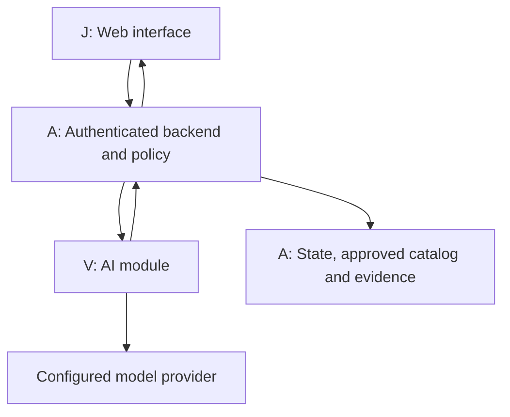

# Mark-1: complete team implementation specification

4 November 2026 | A: backend and integration; V: AI and knowledge; J: frontend.

This combined document contains all Markdown specifications. Companion ZIP also contains the assignable backlog, OpenAPI, schemas, fixtures and runnable artifact checks.


---

<!-- 00-START-HERE.md -->

# Mark-1: three-developer implementation pack

Version: 1.0 | 4 November 2026 (India) | Status: proposed implementation specification, independently reviewed; no product release gate closed.

## What we are building

Mark-1 is a human-in-the-loop assistant for physical troubleshooting. In the first laptop workflow, a person identifies a laptop that will not turn on, provides observations, follows a supported external check, reports the result, and receives the next permitted check or an escalation. The person performs all physical actions. Mark-1 records observations, sources, decisions and human confirmations.

The long-term vision includes diagnosis, learning from verified repairs, overlays and additional equipment. These are separately gated increments, not claims about the current prototype. PAaaS is a positioning choice here, not a certification.

## The division

| Developer | Sole implementation responsibility | Delivers to the others |
| --- | --- | --- |
| A — Ankit | Trusted backend, policy, authentication, database, public and internal contracts, deployment, end-to-end integration | Stable API and fixtures to J; scoped requests/catalog access to V |
| V — Viditya (spelling supplied by user) | AI perception, retrieval, next-check recommendation, model provider integration, offline AI evaluation | A typed recommendation to A; never direct operational instructions to J |
| J | Phone-friendly web UI, camera/upload UX, confirmations, source display, frontend tests | A client that renders server-authorized states and submits human observations |

Skill percentages provided by the user describe strengths, not available working hours. J's backend knowledge is useful for integration review; V's backend knowledge stays inside the AI module. A does not implement their modules by default.

Single code ownership prevents competing implementations. Reviews, contract discussions and integration are deliberately collaborative. Nobody edits another owner's area without an explicit transfer recorded in the ownership register.

## Read these files

1. `01-PRODUCT-AND-ARCHITECTURE.md`: scope, architecture, state and trust rules.
2. `02-OWNERSHIP-AND-HANDOFFS.md`: paths, interfaces, PR rules, existing-code mapping.
3. `03-A-BACKEND-SPEC.md`, `04-V-AI-SPEC.md`, `05-J-FRONTEND-SPEC.md`: individual work instructions and acceptance criteria.
4. `06-CONTRACTS.md` and `contracts/`: OpenAPI definition, request/catalog/response schemas, every state/error fixture and runnable schema checks.
5. `07-VALIDATION-AND-RELEASE.md`: tests, evidence gates, evaluation and release controls.
6. `08-DELIVERY-AND-OPERATIONS.md`: sequence, dependencies, support, privacy and decisions.
7. `09-BACKLOG.csv`: assignable tickets with dependencies and acceptance evidence.
8. `10-ELEPHANT-GOLDFISH-REVIEW.md`: independent review findings and resolutions.
9. `11-GATE-AND-DECISION-REGISTER.md`: reusable evidence and decision templates.

Downloadable ZIP contains all files, including schemas and example payloads. Markdown files are also supplied individually. These are design artifacts; they do not create GitHub issues, modify a repository, deploy a service, or contact teammates.

## Start together, then work independently

On the first shared session, A freezes contract v1 and publishes mock responses; V freezes the supported check/source catalog; J confirms every screen state against those mocks. Then J builds against fixtures, V against the AI port, and A against a deterministic fake engine. A owns the integrated demo.

## Basis and limits

This pack uses the user's team descriptions, laptop example, visible Mark-1 discussion and the current `Vman-Amber-to-Green-Plan.md` read on 4 November 2026. That plan reviewed repository commit `8bd2f05eda8500897775678f9a6842145569be65`. No fresh repository inspection or live model/customer validation was performed for this pack. Proposed paths below are a target layout, not a report of files already present.

The earlier plan intentionally excluded diagnosis from its first industrial pilot. This pack makes an explicit scope change: R0 is a laptop-specific controlled-check demonstration; R1 adds evaluated diagnostic hypotheses in a supervised pilot only after its additional gates pass. The earlier industrial/customer green status does not transfer to laptops. All release criteria in this pack are proposed thresholds, not achieved results or safety standards.


---

<!-- 01-PRODUCT-AND-ARCHITECTURE.md -->

# Product and architecture specification

## Releases and user outcome

| Release | What a user can do | Explicit boundary |
| --- | --- | --- |
| R0 — controlled laptop demonstration | Confirm laptop identity, describe no-power symptom, record observations, follow source-backed allowlisted external checks, save session record | Fictional/licensed test material; AI proposes only check IDs; no causal diagnosis displayed; no customer operational use |
| R1 — supervised laptop pilot | Same flow with a real authorized catalog, evaluated next-check reasoning, separately labeled diagnostic hypotheses when enabled | One supported laptop family, qualified supervisor, explicit escalation; gates in file 07 required |
| R2 — expansion | More symptoms/equipment, verified-repair learning and overlays, each behind separate scope/evaluation decisions | No automatic promotion to broad rollout or autonomous physical action |

First supported symptom: laptop does not turn on. A customer/repair subject-matter expert (SME) chooses the exact family and approves the check catalog before R1. The team must not invent a universal repair checklist from this specification.

R0 covers observation and supported external user checks only. No disassembly, battery handling, energized probing, mains measurements, firmware/BIOS flashing, password/security bypass, or remote execution. Visible damage, liquid, swelling, unusual heat/smell or an uncertain condition triggers a stop and professional escalation. Actual instructions and stop wording are catalog content reviewed by an SME, not generated by the model. Ordinary indicator interpretation also needs model-specific source support.

## User journey

1. Authenticate and create a session with symptom and supported workflow.
2. Capture/upload an image or manually enter a label. Image use is optional.
3. AI proposes identity candidates; the human explicitly confirms model/configuration against the physical label. Ambiguity stops progress.
4. Backend scopes sources and checks to that confirmed asset and workflow; checks authorization, catalog lifecycle and restrictions.
5. A requires a source/SME-approved hazard preflight observation before any physical check. AI then recommends one check ID or asks for a permitted observation. Backend validates prerequisites and releases the current approved instruction text.
6. Human performs the external check and submits a structured observation/confirmation.
7. Backend persists evidence before releasing the next check; then re-evaluates current policy and asks the engine for another candidate.
8. End with an explicitly human-reported outcome, exhausted-check escalation or stopped session. R1 hypotheses are advisory and are never recorded as a verified cause without independent confirmation.

## Architecture



One backend deployment with a module boundary, one database, one web client. No mandatory microservices, queues, vector database, multi-agent runtime, or live video stream. R0 uses image snapshots and an authorized small source catalog; retrieval can be metadata/full-text based. Add infrastructure only when measured limitations require it. Google Elephant–Goldfish is used to review this specification; it is not a requirement for multiple runtime agents.

Proposed stack: retain existing Python Lantern code; add a small Python HTTP layer and a React/Vite/TypeScript UI if no suitable existing UI exists. A records exact framework/runtime/SDK versions after a fresh repository/dependency check in A-01. This specification defines behavior independently of framework syntax and does not claim those dependencies are installed.

## Trust boundary and authority

- J never decides whether work is permitted and never connects directly to a model or vault.
- V treats images, OCR, source documents and user input as untrusted data. It returns typed proposals only, never readiness or approval.
- A computes readiness independently; skipped model calls cannot skip policy. All public responses pass through A.
- A authenticates actor and organization from the session, never request-supplied actor IDs. Every query, object reference, image, recommendation and record is scoped to them.
- A selects authorized catalog entries and evaluates hidden restrictions using an approved policy identity. A generic block may be returned without leaking protected details; unavailable policy returns UNKNOWN.
- V cannot write workflow state or evidence. Its access is read-only and bounded to the current approved source set.
- Changing confirmed identity, symptom scope, configuration or catalog version invalidates the active recommendation and requires a new policy evaluation.

## Authoritative states

Session `status`: `AWAITING_IDENTITY`, `EVALUATING`, `READY`, `RECORD_PENDING`, `BLOCKED`, `UNKNOWN`, `ESCALATED`, `COMPLETED`.

| Transition | Who triggers it | Required condition |
| --- | --- | --- |
| Create → AWAITING_IDENTITY | A | Authenticated, supported workflow |
| AWAITING_IDENTITY → EVALUATING | Human via J, validated by A | Identity confirmed and configuration supported |
| EVALUATING → READY | A | Current checks pass; proposal maps to one authorized check with satisfied prerequisites |
| READY → RECORD_PENDING | Human submits result; A accepts command | Expected session revision and active check match; authorization rechecked |
| RECORD_PENDING → EVALUATING | A | Observation and event durably committed; no unresolved write |
| EVALUATING → COMPLETED | A | Explicit human-reported resolved outcome durably saved; no implication of independently verified repair |
| Any active state → BLOCKED / UNKNOWN / ESCALATED | A | Restriction / unavailable required evidence or service / unsupported or exhausted workflow |

Duplicate commands replay the immutable command receipt/effect, never a stored instructional Session snapshot. Responses reconstruct current authorized Session state even on retry. Wrong/stale commands return conflict and current revision. Terminal states are BLOCKED, UNKNOWN, ESCALATED and COMPLETED. None resumes from late model responses. UNKNOWN is terminal in v1: after resolving the cause, create a new session and repeat required confirmations. A restart reconciles pending commands. No next instruction can be released during uncertain persistence. To start again after a terminal stop, create a new session or use a future separately specified supervisor operation; no hidden override exists in v1.

The operation/state matrix in file 06 is normative. Identification inference returns EVALUATING → AWAITING_IDENTITY with candidates, never READY.

READY responses identify the confirmed asset, current check, exact source version, policy evaluation time and server revision. Before serving a step again or accepting its result, A revalidates; cached READY is never sufficient authorization. J shows an active check as needing refresh after connection loss and does not permit offline continuation. Once shown, content cannot be physically recalled; operators must stop when connectivity/policy is lost.

## Catalog lifecycle

Catalog states: Draft, Approved, Withdrawn, Obsolete. A Draft successor alone does not invalidate a still-authorized release. Explicit withdrawal, obsolescence or supersession revokes affected releases according to an explicit catalog authority record; never fall back to a historical Approved row merely because a newer row is unusable. Missing or conflicting applicability is UNKNOWN. A owns lifecycle enforcement; V owns source preparation, mappings and SME review package. Content hashes and versions are immutable once approved.

## Budgets and failure behavior

Proposed defaults to freeze and verify in A-01: eight model turns, sixteen scoped retrieval/tool calls and sixty seconds wall time per recommendation request. Only one active inference per session revision. Timeout, malformed response, provider refusal, ambiguous identity, exhausted checks or exceeded budget stops/escalates; never bypass policy. Policy evaluation is independent of model budgets.

## Nonfunctional acceptance

Single supported operator/session initially; concurrency correctness must still protect simultaneous tabs/retries. Images: JPEG/PNG, maximum 10 MiB, server checks signature/type and decoded dimensions, rejects decompression bombs and strips metadata before provider use. A chooses tested pixel limits and downsampling in A-01. Documents are ingested by authorized maintainers only, not arbitrary runtime uploads. Secrets remain server-side. Frontend must support keyboard navigation, labeled controls and textual state labels. Session persistence survives restart; no false saved/completed state is acceptable.

## Guidance freshness and hazards

READY includes `guidance_valid_until`, at most 15 seconds after `policy_checked_at`. J refreshes an active visible session every five seconds, immediately on focus/resume and before submission; any refresh failure or expiry hides actionable guidance and disables progression. Hidden/background tabs invalidate locally and revalidate on return. A rechecks current policy on every served READY and accepted observation regardless of expiry. Detection of a silent remote restriction is bounded by polling/network behavior, not instantaneous; this is acceptable only for the bounded external-check workflow and requires SME acceptance. No autonomous action uses this lease.

The first current check is the approved hazard preflight, with enum values CLEAR, HAZARD, UNSURE. CLEAR is a human report, not a guarantee. HAZARD/UNSURE stops deterministically; a new hazard can be reported from every active screen through the hazard command. J immediately hides guidance locally even offline; A invalidates inference/next steps as soon as the stop is received. If a prior evidence write is pending, reconcile it without releasing another check; a durable stop event takes precedence over any next-step result. If storage is unavailable, local stop persists and server returns UNKNOWN rather than claiming a durable stop receipt. Stop conditions and escalation wording are canonical displayed fields, never optional model commentary.


---

<!-- 02-OWNERSHIP-AND-HANDOFFS.md -->

# Ownership and handoff contract

## Rule

Every production file, shared artifact and backlog ticket has exactly one implementation owner. An approver is a reviewer, not a second writer. Never solve a blocked dependency by creating a competing API, model client, schema or persistence layer.

## Proposed repository paths

| Path / concern | Sole owner | Reviewer / consumer |
| --- | --- | --- |
| `mark1/web/**` including web manifest/lockfile/frontend mocks/component tests | J | A reviews integration; V reviews AI-state wording |
| `mark1/server/**` HTTP, sessions, auth, policy, catalog repository, evidence, migrations | A | V reviews AI binding; J reviews API usability |
| `mark1/ai/**` OCR/perception adapter, retrieval ranking, next-check engine, prompts/provider client | V | A reviews security/contract; J reviews display needs |
| `mark1/contracts/**` canonical schemas, fixtures, operation definitions, generated-client configuration | A | Both V and J review before freeze |
| `mark1/knowledge/**` source manifest, versioned checks, applicability/observation metadata, AI eval data | V | A validates lifecycle; SME approves technical content |
| `mark1/tests/integration/**`, `mark1/tests/security/**` | A | Relevant module owner reviews |
| `mark1/ai/tests/**`, `mark1/ai/evals/**` | V | A reviews integrity; SME labels cases |
| `mark1/web/**/tests/**` | J | A reviews contract use |
| Root Python dependencies, lockfiles, CI, deployment, database, environments, monitoring | A | V requests AI dependencies through A |
| `mark1/docs/product/**`, `mark1/docs/contracts/**`, release/gate/decision logs | A | V and J review affected decisions |
| `mark1/docs/ai/**` and source/data/model cards | V | A + SME |
| `mark1/docs/ux/**` and screen/error-state inventory | J | A + V |

Existing `lantern/app.py`, `lantern/bridge/**`, `lantern/mockvault/**`, root `tests/**` and CLI remain A-owned. Existing `lantern/agent/**` becomes V-owned if reused. A must not edit that agent area as part of policy fixes; adapt it in A's caller or request V's ticket. `mark1/` source skeleton was previously reported but has not been freshly inspected here; A-01 reconciles actual paths before assigning tickets. Existing docs outside these new namespaces default to A. No rename/rebuild is required merely to match this proposed layout.

## Shared-boundary decisions

| Boundary | Producer owner | Consumer owner | How change happens |
| --- | --- | --- | --- |
| Public API, sessions, evidence receipts | A | J | A edits contract; J reviews usability; fixtures released before frontend changes |
| Internal inference request/response | A owns schema, V owns implementation | A ↔ V | V proposes requirement; A publishes schema version and fixture |
| Approved source/check catalog | V authors data; A publishes/enforces it | A and V | V provides immutable candidate + SME approval evidence; A validates and activates version |
| UX wording | J owns generic UI text; A owns policy message codes; V owns hypothesis labels | All | Structured codes and approved templates; no model-written imperative text |
| Model/version configuration | V proposes tested model; A deploys credentials/config | V | A records deployed version; provider changes require impacted evaluation |

V's source authoring is distinct from A's catalog storage/migrations. Only A publishes authoritative catalog state. J displays sources received through A and must not maintain a second applicability table.

## Contract change protocol

1. Requestor opens one change ticket: producer/consumers, reason, schema diff, fixture, backward compatibility, migration, impacted tests.
2. A is sole contract editor. J and V review relevant changes; no implementation against an unmerged draft.
3. Freeze v1 before parallel implementation. Additive optional fields are compatible only if old clients still validate and behave correctly; otherwise bump contract version and migrate both consumers together.
4. A checks in fixtures/schema first. J and V generate or consume types; generated files are not hand-edited.
5. Cross-boundary bug: consumer records failing payload/test, producer fixes its own module. Ownership transfer is explicit in the decision log with start/end, affected paths, and replacement owner. Never two simultaneous owners.

## Branches and review

Use short-lived branches `a/<ticket>`, `v/<ticket>`, `j/<ticket>`. Merge contracts → module implementations → integration → release evidence. A owns final integration and tags; J and V merge their module work only after the designated cross-review and checks. Root/shared changes go through A. Keep one PR focused on one owner area; split cross-area fixes into dependent PRs. A publishes a proposed CODEOWNERS mapping and configures protected-branch checks only after actual team GitHub usernames are supplied; initials are not valid substitute handles. No GitHub account or invitation is inferred.

## Handoff checklist

Each ticket hands over: contract version, changed owner paths, runnable/local verification instructions, sanitized request/response example, error cases, remaining limitations, linked source/evaluation evidence and reviewer. Provider keys and customer material never enter fixtures. Reviewer feedback returns to owner. A reviewer may stop a release but does not silently take implementation ownership.

## Preventing A from becoming a bottleneck

A-01/A-02 are the first critical path. Publish stable fakes early and timebox schema discussion to one shared session. V and J continue against frozen contracts while A completes persistence/policy. Avoid new pilot integrations until the laptop thin slice passes. If A's measured capacity cannot meet the plan, reduce scope or explicitly transfer one whole owner area; do not ask all three to edit the backend.

## Test doubles and catalog schemas

A owns `mark1/server/testing/engine_stub.py` to unblock server integration. V owns `mark1/ai/tests/fakes.py` to test provider/AI behavior. They consume shared fixtures and the same port; neither is a second production engine. A owns all schema files, including catalog and engine requests; V owns the corresponding knowledge records. A-02 publishes the pack's complete contract baseline before module branches begin.


---

<!-- 03-A-BACKEND-SPEC.md -->

# A — Ankit: trusted backend and integration

## Own

API, schema authority, authentication, session state, storage/migrations, catalog publication, current-policy enforcement, source lifecycle, evidence, secure model egress boundary, deployment, observability, end-to-end release evidence. A is final technical integrator, not a substitute frontend/AI developer.

## Build in this order

1. **A-01 baseline and decisions.** Freshly inspect the repo and applicable instructions; record commit/runtime/dependencies, existing tests, reusable Lantern components, final paths and framework. Resolve pilot laptop family, workflow/source owner, provider-data permission, human reviewer, budgets, limits and team capacity. Use synthetic data while permissions are unresolved.
2. **A-02 contracts and mocks.** Publish schemas from this pack in the repository contract area, define full public session envelopes, implement the A-owned deterministic server integration stub at `mark1/server/testing/engine_stub.py` and response fixtures for all UI states. Own the one canonical public API definition. Fix contract ambiguities before parallel implementation.
3. **A-03 state/storage/auth.** Durable sessions, immutable event log, catalog revisions, image metadata, observations, inference runs and idempotency table. Tenant/actor scope every read/write. Reject unauthenticated, cross-session and stale commands. R0 local seeded identity must be visibly demo-only, unreachable in R1 deployment.
4. **A-04 trusted policy.** Bind confirmed identity/task, recheck current permissions/restrictions per check and confirmation, validate candidate check/source/prerequisites, fail closed, enforce workflow/tool allowlists, reject stale or late model outputs and prevent raw model advice reaching UI.
5. **A-05 evidence and lifecycle.** Atomically persist human observation, evidence event, session revision and idempotency result. Reconcile timeout/restart. Distinguish human assertion, pending write and persisted receipt. Implement withdrawal/supersession with no historical approval fallback.
6. **A-06 integrate/security.** Replace fake engine with V's port. A controls scoped engine input and allowlisted egress; V owns provider logic. Enforce file input limits, redaction, permissions, per-request budget and generic protected restriction blocks. Wire J's client to HTTP layer.
7. **A-07 release/ops.** Environment management, reproducible checks, backup/restore exercise, data retention/deletion, sanitized logs, kill switch, rollback and release-gate evidence. No secrets in client or logs.

## Storage contract

One transactional store initially. Minimum entities: sessions (tenant, actor, asset/configuration, workflow, status, revision), events (append-only, human assertion/source/policy/request references), observations, catalog/check versions and applicability, image objects, inference runs (model/prompt/catalog versions, duration, outcome), idempotency commands (key, request hash, status, result). IDs must be opaque and authorization-checked; unguessability is not authorization.

Use a transactional outbox only if an external evidence system is required. R0 local durable storage suffices; do not introduce distributed writes prematurely. If R1 uses an external vault, a local commit is not proof of external success: keep RECORD_PENDING until the required authoritative system acknowledges, reconcile by stable key and stop progression on uncertain/denied writes.

## Idempotency and concurrency

Every mutation requires `Idempotency-Key` and `expected_revision`. Scope keys by tenant + actor + session + operation; creation uses tenant + actor + operation. Store a canonical request hash. Same key/same payload replays the original immutable command receipt/effect together with freshly authorized current Session state; never replay stored check instructions; same key/different payload is 409. A stale revision with a fresh key is 409. Transactional compare-and-update prevents two tabs completing different checks. Authenticate/authorize access first, then deduplicate before stale-revision rejection for legitimate retries. Previously authorized effects do not grant current read access. Active inference IDs bind revision, asset, catalog and policy context; discard late results when any changes. Persisted receipts never imply independent physical verification.

## Error taxonomy

401 unauthenticated; 403 unauthorized; 404 nonexistent or inaccessible object (no enumeration); 409 revision/key/state conflict; 413 too large; 415 unsupported media; 422 malformed/unsupported request; 429 budget/rate limit; 503 required service unavailable. Known restrictions return a valid session with BLOCKED, not a fabricated system outage. Response error envelope contains stable `code`, user-safe `message`, `request_id`, `retryable` and optional `current_revision`. All error responses suppress actionable instructions.

## Acceptance

- Direct HTTP callers cannot bypass policy even without using the frontend or engine.
- All historical Lantern failures from the prior plan have regression coverage: skipped blocker call, obsolete fallback, hidden critical restriction, uncontrolled final text.
- Same session/check submission retried after timeout/restart creates exactly one logical observation/evidence event.
- Wrong organization, forged actor, mismatched asset/source, stale catalog/permission, source withdrawal and model-selected excluded checks stop progression.
- One offline demo works with fake V and J fixtures; then an integrated demo works with V's real adapter in an authorized environment.
- Backup restore, kill switch and pending-state recovery are demonstrated before R1.

## Do not own

Do not build the React screens, prompt design, image reading engine, retrieval ranking, diagnostic algorithm or AI evaluation dataset. File bugs/contract changes to J/V. A may inspect and review all areas.


---

<!-- 04-V-AI-SPEC.md -->

# V — AI, knowledge and recommendation engine

## Own

Perception, supported identity extraction, source preparation, retrieval ranking, bounded next-check reasoning, model/provider adapter, prompts, AI-module tests, labeled evaluation design and model/data cards. Backend work is confined to this AI module; no public API, workflow database, auth or evidence implementation.

## Inputs and outputs

Consume the immutable inference request defined in `06-CONTRACTS.md`: confirmed scope, consent-cleared image references, approved authorized checks/source excerpts, prior structured observations, already completed checks, contract/catalog/prompt/model versions, budgets and execution ID.

Return an `EngineProposal` conforming to `contracts/engine-proposal.schema.json`. Kinds: `IDENTITY_CANDIDATES`, `PROPOSE_CHECK`, `ASK_OBSERVATION`, `ESCALATE`. Return IDs and source references; A retrieves canonical instruction text and performs final checks. No raw generated instruction text, readiness, evidence receipts, authorization decisions, commands or actor overrides.

## Tasks

1. **V-01 catalog + fake implementation.** Prepare one supported no-power workflow using synthetic or licensed documentation. Each check: immutable ID/version, supported models/configurations, prerequisites, approved observation question/options, authored instruction text, risk class, stop conditions, source ID/version/locator/hash, approval status and reviewer/date. Deliver fixtures for every engine kind. A owns schema and publication; V owns data authoring.
2. **V-02 perception.** Optional image snapshot → identity candidates and evidence locators; return ambiguity/unsupported states honestly. No invented serial number or false precision. Manual confirmation remains required. Demonstrate similar valid IDs, glare, cropped labels, unknown families and injected text. Image absence must still support manual entry.
3. **V-03 retrieval.** Use A's already scoped current approved subset; rank relevant sources/checks within it. Never retrieve another tenant, asset family or hidden restriction. Empty/conflicting coverage escalates. Small catalog first; no vector service unless a measured retrieval need justifies it.
4. **V-04 next-check engine.** Pick one supported check with satisfied catalog prerequisites, request one supported observation or escalate. Prevent loops and redundant checks. R0 may rank hypotheses internally to choose checks but cannot expose causal diagnosis as a product conclusion. Model output is an untrusted proposal; A revalidates it.
5. **V-05 provider and budgets.** Configurable provider/model, server-only keys supplied by A, structured response parsing, schema validation, timeout/cancellation and bounded retry. Retries count against the original deadline/call budget and do not mutate sessions. Keep V-owned provider/engine test doubles at `mark1/ai/tests/fakes.py` for AI tests. These do not duplicate A's server integration stub; A can later consume V's real module or a shared fixture through the frozen port.
6. **V-06 evaluation + R1 proposal.** Freeze held-out cases before tuning, report by condition/model family, exact identity/refusal/coverage, valid next-check rate, escalation quality, unsupported-source rate, latency and actual tokens/cost. Only then propose a separately evaluated hypothesis schema/feature flag for R1. V does not self-approve that release.

## Prompt and data security

Document and image instructions are data, never system instructions. Scope tool requests to the current session's provided allowed IDs. Do not expose internal prompts, secrets, protected restrictions or unrelated source text. Never call external URLs found in a label/document. Minimize image transmission; use only consent-cleared references after A authorizes provider handling. Model fallbacks must not silently change provider or data terms.

## Diagnosis and future learning

R1 hypotheses require a future contract amendment: ranked possible causes with evidence-for/against, uncertainty and a labeled advisory status; confidence scores must not be described as calibrated probabilities without evaluation. SME-approved actions remain the only displayable checks. A model saying "fixed" does not end a job.

Later Bayesian diagnosis/information-gain selection, verified-repair learning, training gym and drift monitoring remain V-owned algorithm work. A owns persistence, promotion controls and audit; J owns visualization. No online self-training or automatic autonomy promotion in R0/R1. Verified cause needs an SME-defined independent confirmation label distinct from a user completion click.

## Acceptance and handoff

- Valid schema on every response or explicit handled failure; unknown IDs/sources rejected before handoff.
- All evaluation cases keep request/catalog/asset binding intact; no actionable advice outside catalog.
- Provider failure/malformed response/malicious source/exhausted budget cannot turn into a successful check.
- Held-out results include denominators, excluded/unreadable cases, false acceptance, refusal, coverage and costs, not just average accuracy.
- Deliver prompt/model/catalog versions, sanitized examples, fake engine, evaluation instructions and known limitations to A; source/uncertainty labels to J through the contract.

V may ask J for how a result will be displayed, but never ships a second frontend or direct browser-to-model connection.


---

<!-- 05-J-FRONTEND-SPEC.md -->

# J — phone-friendly frontend

## Own

All web screens, camera/file capture, manual fallback, client state rendering, structured observations, accessibility, frontend API wrapper and UI tests. Consume A's API; do not implement policy, source applicability, evidence storage or model/provider requests.

## Screens and behavior

| Screen | Required behavior | Important failure state |
| --- | --- | --- |
| Start | Show supported workflow and demo/pilot label; collect symptom | Unsupported task cannot continue |
| Identify | Snapshot/upload or manual label entry; show candidate and explicit confirmation | Camera denial, unreadable label, unknown model; manual fallback |
| Review identity | Show exact model/configuration and ask user to compare physical label | No automatic confirmation from model confidence |
| Guided check | One server-authorized check, canonical instruction, source/version, approved observation form | BLOCKED/UNKNOWN/ESCALATED hides next actions |
| Save result | Submit structured human observation with expected revision and stable idempotency key | Pending/timeout is not saved; retry reconciles same command |
| Summary | Distinguish human-reported resolved/unresolved from durable evidence status; show references | Missing receipt does not display a success tick |
| Session recovery | Fetch authoritative server state, reconcile pending submission, refresh policy | Offline or stale tab cannot continue from cached READY |

No unrestricted chat is needed for R0. Symptom text is untrusted input; observations use catalog-defined fields/options. Do not turn user text, OCR or AI text into HTML. External/source links must be authorized URLs supplied by A; render safely.

## Tasks

1. **J-01 state inventory and prototype.** Produce compact wireframes and a state-to-screen table; use A's fake responses for every state. Show clear text labels as well as colors. Design for a phone used beside a laptop; avoid an overlay/video requirement.
2. **J-02 capture + identity.** Camera permission flow, image preview/retake, upload feedback, manual fallback and explicit human identity confirmation. Client limits help UX; A still validates all bytes.
3. **J-03 guidance + observations.** Render canonical server-supplied check/source and structured observation controls. No inferred authorization from missing fields or a model message. Display pending and blocked states unambiguously.
4. **J-04 retry + recovery.** One stable idempotency key per intentional action; preserve only minimal pending command metadata securely across transient failure, never assume a fresh key is a retry. On reload, GET authoritative session and reconcile through A. Stale revision prompts refresh; no automatic resubmit of a different payload.
5. **J-05 summary + UI checks.** Show durable receipt and explicitly human-reported outcome; keyboard labels/focus, mobile layout, screen-reader state updates and clear escalation. Component and API-fixture tests cover all states. Submit J's UX acceptance evidence to A.

## Data/security boundaries

Use same-origin authenticated requests; no provider keys/client secrets/local authorization flags. Do not store raw images, source documents or full sessions in browser persistent storage. If minimal pending-key persistence is needed, agree its scope/expiry with A. Clear it after confirmed receipt/logout. Do not log images, serials, tokens or document excerpts in console/analytics. Connectivity loss marks displayed guidance stale and disables progression pending server revalidation. Logout removes private client state.

## Acceptance

- A new user can complete the fake-engine happy path without instructions from the developers.
- Every API status/error has an explicit usable screen; camera denial is recoverable.
- Double tap, slow response, reload and lost response never show false completion or create a second intentional command.
- Withdrawing authorization, catalog update, stale session, outage or unknown identity stops the next action visibly.
- Model prose cannot become HTML or operational guidance. Sources, human-confirmation labels and saved/pending distinction remain visible.
- J's frontend works against fixtures while A/V continue implementation; switching to real API requires only configured endpoint/auth, not a second business-rule layer.

J can review backend API design using their backend experience. Any implementation outside `mark1/web/**` returns to its owner.

## Freshness, hazards and stop

Poll active visible sessions every five seconds; hide instructions on refresh failure, 15-second lease expiry, tab backgrounding or loss of connectivity. On focus/resume, fetch current state before restoring guidance. Always show canonical safety notice/stop conditions and a Report hazard / Stop control. Reporting a hazard locks the UI immediately, including offline, then reconciles with A using the same command key. Do not let a pending ordinary observation override a local stop. The backend remains authoritative; the UI cannot guarantee immediate remote-revocation detection.


---

<!-- 06-CONTRACTS.md -->

# Contract v1 — public API and internal AI port

Sole schema editor: A. Reviewers: J and V. These are normative behavior contracts, not an implemented server. `contracts/session.schema.json` and `contracts/engine-proposal.schema.json` define response envelopes. The included `public-api.openapi.json`, request/catalog schemas and examples are the contract baseline. A-02 must verify framework representation and generated client types before implementation; it cannot silently change these semantics.

## Common conventions

HTTPS for pilot. Authenticated same-origin session/cookie or equivalent server-verified token; choose and record one in A-01. Cookie deployments require CSRF protection on mutations and secure/HttpOnly/SameSite settings. Every ID/reference is authorization-checked. Tenant and actor are obtained from auth, never trusted from body. Timestamps are UTC RFC3339; display in user's local time. Contract version is `1.0`. All mutation bodies forbid unknown fields. All mutations require an `Idempotency-Key` header; session mutations also require integer `expected_revision`. HTTP errors use the envelope from A's spec. Body IDs cannot override URL IDs.

## Public operations

| Operation | Request body (besides common fields) | Response / behavior |
| --- | --- | --- |
| `POST /v1/sessions` | `workflow_id`, `symptom_code`, optional bounded `symptom_text` | 201, Session AWAITING_IDENTITY; only allowlisted workflow/symptom |
| `POST /v1/sessions/{id}/images` | Multipart image file + expected revision + purpose `identity` | 201 `{image_id, session_id, revision, status: STORED}` after safe processing; no model call until authorized data terms; failures do not imply identity |
| `POST /v1/sessions/{id}/identity-candidates` | `expected_revision`, optional session-owned `image_id`, optional `manual_label` | 202 Session EVALUATING; poll GET; engine result becomes AWAITING_IDENTITY with candidates; failure → UNKNOWN; no instructions |
| `POST /v1/sessions/{id}/identity-confirmation` | `expected_revision`, `model_id`, `configuration_id`, optional `serial`, `human_confirmed:true` | 202 Session EVALUATING; confirm only supported model/configuration; bind identity, invalidate old proposals, begin independent policy evaluation |
| `GET /v1/sessions/{id}` | None | 200 current Session; READY must be freshly revalidated before return; include no protected details |
| `POST /v1/sessions/{id}/observations` | `expected_revision`, `check_id`, `check_version`, `observation_code`, `value`, optional session-owned `image_id`, `human_confirmed:true` | 200 persisted Session or 202 RECORD_PENDING; check/value schema must match active check; persist before reevaluation; retry same key |
| `POST /v1/sessions/{id}/outcome` | `expected_revision`, `human_reported_outcome: RESOLVED or UNRESOLVED`, `human_confirmed:true` | RESOLVED → COMPLETED only after persistence; UNRESOLVED → ESCALATED; no model can call this operation |
| `POST /v1/sessions/{id}/stop` | `expected_revision`, `reason_code` | 200 Session ESCALATED after durable stop event; invalidate pending inference |
| `GET /v1/sessions/{id}/events` | Optional pagination cursor | Authorized human/evidence/source summary; paginated immutable records with receipts; not model debug text |

Terminal session mutations return 409 except an authenticated/authorized replay of an already accepted command effect. Replay returns its immutable receipt plus freshly evaluated current Session, never old instructions. Long-running image/AI operations use 202 + GET polling (proposed one-second polling with capped backoff); no WebSocket/SSE required. Background request handling must survive/reconcile restart; use persisted job state or return a controlled UNKNOWN, never fabricate READY. `GET` never submits a new inference, confirmation or physical action.

`identity_candidates` objects contain `model_id`, `configuration_id`, `label_excerpt` and `basis: IMAGE or MANUAL`; they never claim physical truth. Limit candidates to three. Serial is optional and minimized; store only when applicability requires it. Manual labels still need human comparison/confirmation. If no supported match exists, offer escalation, not a closest-model guess.

`value` is typed according to the approved check's observation schema, not arbitrary executable text. Initial v1 forms use string enums only (including YES/NO where appropriate); no numerical instrument interpretation. A-02 freezes code/value constraints, input text bounds and allowed enum sets with V's catalog. Any optional note is evidence only and cannot change prerequisites without an explicitly supported observation.

## Session envelope semantics

Every response conforms to the schema. `revision` is a monotonic integer changed by state-changing events. `identity` is null until confirmed; candidate identities stay in `identity_candidates`. `current_check` is non-null only for READY. `receipt` refers to the last accepted human command, not AI output; a PERSISTED receipt includes a durable record ID. `human_reported_outcome` is never named verified repair. Non-ready responses cannot carry instructions. `reason_code` is safe structured explanation, never arbitrary model prose. Schema validity alone does not establish current authorization; A must enforce runtime invariants.

## Internal port

V implements one module entry point `propose(request) -> EngineProposal`, with cancellation/deadline support in the chosen Python implementation. A calls it; J cannot. V can stub/fake it without running HTTP.

`request` fields (owned/frozen by A): `contract_version`, `request_id`, `session_id`, `based_on_revision`, `context_hash`, `mode` (`IDENTIFY` or `NEXT_CHECK`), `workflow_id`, `confirmed_identity` (null only in IDENTIFY), `manual_label`, `cleared_images` (session-scoped sanitized image bytes/references, never arbitrary URL fetches), `approved_catalog` (check and source ID/version/hash, approved text, prerequisites and observation schemas), `observations` (typed values and provenance), `completed_check_ids`, `remaining_budgets` (turns, calls, wall-time deadline), `model_config_version`, `prompt_version`, `catalog_version`.

A computes `context_hash` over canonical decision-relevant input, excluding transient transport fields. A persists the inference request binding. An engine response must exactly echo request/session/revision/hash; mismatch or late response is rejected. Context binding is a correlation control, not proof the model reasoned correctly. Neither actor nor tenant may be supplied/changed by the model. A passes only authorized material and scopes any V retrieval to that input.

`EngineProposal` kinds:

- IDENTITY_CANDIDATES: up to three candidates from approved supported IDs; no auto-confirmation.
- PROPOSE_CHECK: exactly one approved `check_id` and `check_version`, references to approved sources; no instruction prose.
- ASK_OBSERVATION: a `check_id`, `check_version` and `observation_code` defined by the active catalog and its source references; A must map it to a canonical approved question/check. It is not a loophole for arbitrary checks.
- ESCALATE: safe enum reason `INSUFFICIENT_EVIDENCE`, `UNSUPPORTED`, `CONFLICT`, `EXHAUSTED`, `MODEL_FAILURE`, `BUDGET_EXCEEDED`.

## Source and check authority

Authoring record: source ID/version/hash/title/locator/rights, approved audience, model/configuration applicability, lifecycle and approver; check ID/version, canonical instruction, prerequisites, approved observation schema, stop conditions, source refs and risk/scope tags. V authors, SME signs technical content, A publishes and enforces. Inference cannot approve or mutate these records. A resolves output references against the current catalog, including permission/revocation, before displaying anything.

## Fixtures and change gate

`contracts/examples.json` contains a READY session, a pending session and an engine proposal; all status/error/engine-kind fixtures are included in `contracts/all-fixtures.json` under the same schemas. Contract checks must reject READY without a check, non-ready with a check, pending with PERSISTED receipt, persisted without record ID, stale response binding and additional model instruction fields. J and V consume these exact fixtures rather than copying altered shapes. Public API/schema/examples are a single versioned contract; drift blocks merge.

## Normative operation/state matrix

| Operation | Allowed starting states | Result / special rule |
| --- | --- | --- |
| create | No existing session | AWAITING_IDENTITY |
| image upload, identity candidates, identity confirmation | AWAITING_IDENTITY only | Identity inference temporarily EVALUATING, then AWAITING_IDENTITY; confirmation → EVALUATING |
| GET session/events | Any authorized state | No new inference or human action; refresh current policy before returning READY |
| observation | READY only | Active check/version/observation/value must match; RECORD_PENDING until durable; then EVALUATING |
| outcome | READY or EVALUATING after >=1 durably recorded check observation | No pending write; cancel active inference; persist before COMPLETED/ESCALATED |
| stop or hazard | Any nonterminal state, including RECORD_PENDING | Immediately inhibit future instructions; reconcile pending event; persist stop; no completion or next-check release |
| ordinary mutation while RECORD_PENDING | None | 409; exact authorized command replay allowed |
| ordinary mutation in terminal state | None | 409; exact authorized command replay allowed |

New hazards always take priority over a normal observation/outcome. `/hazards` is a dedicated mutation with expected revision and `hazard_code` enum DAMAGE, LIQUID, SWELLING, HEAT_OR_SMELL, UNSURE. For a valid authorized active session it is accepted even with a stale expected revision: stopping is monotonic, may not change asset identity, and must not be defeated by an inference race. `/stop` has the same monotonic exception. Key/payload conflict is still 409. J locks locally before network acknowledgement. A returns a truthful PENDING or persisted receipt; never releases guidance while reconciliation is unresolved.

Public schemas and examples are illustrative of data structure, but their enum-only observation forms and all state constraints are normative v1 behavior. Richer booleans, numbers, multiple-source display or diagnosis payloads require a contract amendment. Each check displays one canonical primary source; the authoritative catalog may preserve additional references, but A must not omit any safety-critical condition when composing canonical instruction/stop fields.

The Session `receipt` always describes its current latest accepted human command; it must not be overwritten with an older receipt during replay. Successful mutations return `X-Command-Id` and `X-Command-State` headers to identify the original command effect independently of current Session state. `GET /v1/sessions/{id}/commands/{command_id}` returns that authorized command's receipt (`command_id`, `state`, `record_id`); reconciliation may update PENDING to PERSISTED but never create a second effect. Historical receipts contain no instruction snapshots. A command may have committed yet now be inaccessible to a revoked caller; authorization always precedes replay. The image-upload receipt is separate from human-work evidence and obeys the same authorization/replay rules.

Catalog publication rejects duplicate check/version identities, unsupported configuration mappings, cycles, invalid prerequisite values and missing source/approval references. Exactly one required preflight is defined per workflow/configuration. Every physical check must transitively depend on the current approved preflight's CLEAR value; hazard/UNSURE stops before engine choice. No request, model proposal or human outcome can bypass this invariant. Runtime binding/value/prerequisite/expiry checks remain necessary beyond schema validation.

## Hash and clock conventions

Engine request schemas are in `engine-request.schema.json`, with reusable definitions in `catalog.schema.json`. `context_hash` is SHA-256 over UTF-8 JSON of `mode`, `workflow_id`, `confirmed_identity`, `manual_label`, `cleared_images` metadata, `approved_catalog`, `observations`, `completed_check_ids`, `catalog_version`, `prompt_version` and `model_config_version`, serialized by the canonical A-owned serializer: keys sorted recursively, compact separators, no NaN/Infinity, ASCII escapes, integer numeric fields only, input array order preserved. Request ID, deadline, counters and hash itself are excluded. A creates the hash, records the exact serialized bytes and validates the echoed hash; V does not independently reinterpret hashing. Image bytes are represented by their content SHA-256 in metadata; only A-authorized opaque handles can resolve to bytes. Deadline is an absolute UTC RFC3339 `deadline_at`; A also enforces a monotonic wall-clock elapsed deadline. No duration unit is inferred.


---

<!-- 07-VALIDATION-AND-RELEASE.md -->

# Validation and release gates

Criteria below are proposed. No tests, photo benchmark, pilot or customer payment is claimed complete by this specification. Specification schema checks and Goldfish reviews are recorded separately.

## Test ownership

| ID / requirement | Implementation test owner | Reviewer / witness | Required observable result |
| --- | --- | --- | --- |
| T01 skipped checks and direct HTTP bypass | A | V | No check text until independent policy passes |
| T02 withdrawn/obsolete/superseded vs Draft | A | V + SME | Revoked release denied; still-authorized release not wrongly revoked by draft alone |
| T03 hidden restriction/denied policy service | A | V | Generic BLOCKED or UNKNOWN, no protected detail leakage |
| T04 actor/tenant/asset/configuration/source binding | A | V | Forged/mismatched/stale requests rejected |
| T05 timeout, duplicate key, key payload mismatch, restart | A | J | One logical evidence event; pending never shown saved; current revision returned |
| T06 simultaneous tabs, late inference, stop during inference | A | J + V | One valid transition; terminal state never revived |
| T07 provider refusal/malformed output/budget exhaustion | V | A | Explicit handled failure; no unsupported check/instruction |
| T08 image/document prompt injection, unscoped lookup | V (engine) + A (separate egress tests) | Cross-review by other owner | No unauthorized tool/lookup/output/data transfer; separate test paths |
| T09 identity, wrong-valid model, unsupported configuration | V | SME + A | Record raw extraction and post-confirmation errors separately |
| T10 denied camera, offline/reload, pending receipt, accessibility | J | A | Manual fallback, no stale continuation or false success |
| T11 integrated no-power happy path and each failure branch | A | J + V | Trace from input to scoped source/check, observation and durable receipt |
| T12 backups, restore, policy kill switch, deletion | A | V + independent reviewer | Restore verified; stop/recovery rehearsed; deletion evidence recorded |
| T13 hypotheses/next-check value and escalation (R1 only) | V | SME independent of engine tuning | Held-out results and uncertainty accepted; wrong recommendations cannot bypass catalog |

Rows with two modules contain separate tests owned within each module; no shared test file has two writers. A owns end-to-end acceptance wiring. Existing prior tests are rerun with declared dependencies in a clean environment; do not inherit the old pass count as a new result.

## Gates

| Gate | Accountable implementation lead | Evidence / proposed condition |
| --- | --- | --- |
| G0 scope, rights and contracts | A | One laptop family/symptom, authorized sources and images, SME-approved checks, frozen v1 contract, data terms, operator/stop boundaries; demo remains synthetic until authorized |
| G1 deterministic policy and persistence | A | T01–T06 pass; no open critical bypass/false evidence result; output cannot carry raw operational model advice |
| G2 perception and engine | V | At least 100 held-out images with varied readable/unreadable/near-match cases; zero accepted wrong assets/configurations in that set; >=90% usable coverage on readable supported images; all unknown/unreadable cases refuse or request confirmation; per-condition and pre-/post-human results reported; T07–T09 pass |
| G3 supervised pilot environment | A | Real auth, tenant permissions, lifecycle, storage, authorized provider use, retention, recovery, T10–T12; customer/admin + SME + independent reviewer accept this bounded environment |
| G4 diagnostic increment | V delivers evidence; A controls release | Separate hypothesis contract/feature flag, held-out no-power cases, independent SME labels, calibrated-claim limits, next-check/escalation results and no unsafe/out-of-scope action acceptance; predeclare sample size/targets before tuning; T13 passes |
| G5 user value and cost | A | At least 30 matched task pairs, >=20% lower median task completion time without observed worsening of errors, tail time or supervisor effort; costs include setup/support/model; report uncertainty and all attempts |
| G6 commercial validation | A | Five buyer interviews across >=3 buying organizations, two independent scoped pilot commitments and one paying customer; actual measured economics support next bounded deployment |

R0 developer demonstration: synthetic/licensed test catalog, frozen contracts, integrated deterministic controls and truthful labels; no customer-green claim. R1 controlled-check pilot requires G0–G3. Diagnostic hypotheses must remain disabled until G4 also passes. G5–G6 support a next bounded paid deployment, and its own impacted G0–G4 must be satisfied. No broad rollout or autonomy is authorized by passing these gates.

G2's finite sample is not proof of a zero real-world error rate. Human confirmation helps but is itself fallible. Record correction rate, refusal and coverage separately to avoid hiding bad extraction behind operator fixes. Identity must be tied to applicability, not merely a matching database row.

## Evaluation protocol

V prepares a manifest of held-out cases, sources, expected identity/allowed next checks, stop labels and independent repair/SME reference where relevant. Split by device/session/source families to avoid near-duplicate leakage. Lock the evaluation set before prompt tuning. Record model/provider/prompt/catalog/contract versions, sample counts, excluded cases, exact-match results, accepted wrong-valid IDs, refusal, coverage, escalation and unsupported-source outputs. Report latency median/tail and per-run actual usage costs; do not invent provider prices.

For R1 diagnostic planning, choose sample size and acceptance target with the SME based on severity and workflow before evaluation; until specified and met, G4 is UNKNOWN. This is an explicit future gate, not a zero-decision implementation ticket for hypothesis display.

Value study: counterbalance existing-process and Mark-1 ordering where feasible; pair comparable tasks, count failed/refused attempts and supervisor time, specify start/stop timing and tail statistic before collection, record learning/order effects and uncertainty. Small samples cannot establish safety. A owns study records; the SME validates technical outcomes. No paid claim without actual payment evidence.

## Release decision

A attaches test run IDs, commit/config/catalog/model hashes and open limitations to the gate register. Module owners do not self-certify domain safety. Named external SME/customer/admin/independent reviewer roles must be filled before an operational pilot. They are not assumed to exist. If unavailable, stay at developer demo. Any severe incident, source withdrawal, permission uncertainty, policy outage, model/data-term change or failed persistence stops impacted work; rerun affected gates after remediation.

## Identity acceptance metrics and freshness regressions

Count raw exact candidates, explicit unreadable/unsupported abstentions, wrong-valid candidates, human corrections, and final backend-accepted asset/configuration as separate numerators and denominators. Ordinary mandatory human confirmation is not an abstention. Unreadable/unsupported test inputs must elicit explicit uncertainty/refusal, not confident fabricated candidates. Zero accepted wrong IDs means zero wrong final backend acceptances in the held-out set after the entire workflow; also report raw engine errors to expose reliance on human correction.

T05 additionally tests original-command retry after source revocation and after terminal stop: command effect/receipt is stable but current guidance is absent. T06/T10 include idle-screen expiry, background/resume, lost polling, stale hazard/stop during inference and pending writes. T01 requires preflight before any physical check, and HAZARD/UNSURE causes deterministic stop. A schema pass does not replace these runtime tests.


---

<!-- 08-DELIVERY-AND-OPERATIONS.md -->

# Delivery sequence and operations

## Planning assumptions

Three developers; availability and budget unspecified. Use effort ranges as planning estimates, not dates/promises. One shared integration window per workday when active. No new customer connector, advanced diagnosis display, AR or learning in the initial thin slice. A owns all schedule decisions and records actual capacity after kickoff. SME/customer availability may dominate elapsed time.

## Dependency schedule

| Stage | A | V | J | Exit |
| --- | --- | --- | --- | --- |
| 0: align (1–2 focused days estimate) | Repo/dependency baseline, scope/rights, contracts/fakes | Draft synthetic check catalog and engine examples | Screen/state prototype using examples | A-01/A-02 + V-01 + J-01 contracts aligned; unresolved pilot decisions recorded |
| 1: independent build (roughly 4–7 focused days per developer estimate) | State/auth/policy/evidence using fake V | Perception/retrieval/next-check using frozen port | Capture/confirmation/guidance using frozen API fixtures | Owner tests and all status/error fixtures pass |
| 2: integrate (roughly 2–4 focused days estimate) | Own integrated API, security and recovery | Replace fake engine, fix AI binding failures | Replace API mocks, fix UX/retry failures | One full synthetic no-power session plus failure matrix demonstrated |
| 3: evaluate/harden (estimate only after baseline) | Gate evidence, staging/ops, independent review | Held-out evaluation and model/data cards | Usability/mobile/accessibility acceptance | Developer-demo criteria satisfied; G0–G3 evaluated for bounded pilot |
| 4: R1 and value study (depends on evidence/access) | Pilot operations, measurements and commercial interviews | Separately gated hypotheses/diagnostic evaluation | R1 display only after contract amendment | G4 if hypotheses enabled; G5/G6 assessed, never assumed |

Stage estimates are not additive calendar commitments and exclude unknown access/SME waits. If the team is part-time, schedule proportionally to confirmed working capacity. Work can start independently only after its input contract/fixture exists. A is not allocated full-time simultaneously to every role; defer nonessential connectors/advanced work if capacity is exceeded.

## Daily integration protocol

Each owner posts ticket state, contract version, demonstrated behavior, blocker and next handoff in the project record. No message is sent by this specification. A resolves shared-contract blockers first; discussion cannot authorize an unsafe shortcut. Weekly (or each milestone) demonstrate one complete workflow rather than three isolated modules. Every defect has one owner determined by the failing boundary, not whoever first sees it.

## Configuration and secrets

A controls deployment config: environment, contract/catalog version, enabled workflow, diagnosis flag (off in R0), provider/model/prompt versions, request budgets, file limits, retention and emergency stop. V provides model requirements; J gets only public endpoint/config. No keys in repo, client, screenshots or exported reports. Model changes rerun relevant tests. Use synthetic images until source and provider rights are established.

## Observability

Record correlation/session/inference/command IDs, state transitions, latency, result codes, catalog/model/prompt versions, tool/budget counts, persistence reconciliation and safe error category. Do not log raw images, serials, access tokens or document content by default. Track wrong-identity acceptance, refusal/coverage, unsupported candidate rejection, escalations, pending-write age, provider error and actual usage cost. A owns telemetry; V owns engine metrics; J owns sanitized UX error events sent through A.

## Data handling and retention

A documents who can view images, sources, observations and evidence; V only processes the scoped subset; J receives authorized display fields. Default R0 uses synthetic data only. For R1, A records approved retention periods, lawful/contractual basis and provider terms with the customer/admin before collection. Prefer dropping raw images after the approved short retention period; retain minimized audit references only as authorized. Deletion must cover objects, database references, derived copies and backup expiry policy; explain any required audit retention. No training reuse without separate rights and an approved evaluation plan.

## Runbook

1. Incident or unsafe/unknown behavior: operator stops physical work and escalates; J shows stop state; A disables impacted workflow/model via server kill switch.
2. Preserve minimal authorized correlation/evidence; never paste sensitive payloads into public issues.
3. A diagnoses policy/storage/auth; V diagnoses provider/perception/reasoning; J diagnoses capture/display/retry. Each fixes its own module.
4. Pending writes reconcile by idempotency key before retry; do not manually mark complete. Lost authorization or withdrawn sources invalidates active guidance.
5. Restore only a compatible server/schema/catalog set. A rehearses restore/migration and documents rollback; destructive migrations need a tested recovery strategy. Do not roll back to revoked content or authorization state.
6. Rerun impacted gates; independent SME/reviewer approval is needed where pilot conditions changed. Inform operators of accepted limits before resuming.

## Future-work ownership

| Increment | V | A | J |
| --- | --- | --- | --- |
| Bayesian/information-gain diagnosis | Algorithm, calibration and benchmark | State/source/policy integration | Hypothesis and evidence views |
| Verified-repair learning | Learning pipeline and leakage controls | Rights, labels store, version promotion/audit | Expert confirmation UX |
| Training gym | Simulator/evaluations | Reproducible execution and release boundaries | Optional result dashboard |
| Drift/CUSUM | Detection method and false-alarm evaluation | Authorized telemetry and alert workflow | Alert display |
| AR guidance | Perception/coordinate proposals | Session/budget/policy binding | Camera overlay rendering |
| Equipment/customer expansion | New domain evaluation/catalog | Connector/auth/lifecycle and customer gates | Supported-device UX |

These are deferred increments, not parallel first-sprint deliverables. Physical autonomous actuation needs a separate architecture and task-specific safety case.

## Capacity commitment rule

The 4–7-day module range is a provisional planning placeholder, not an implementation commitment. Stage 0 must separately estimate A's policy/persistence work and A's operations/integration work, and confirm each person's available hours before setting dates. If capacity does not fit, keep R0 synthetic and defer connector/ops/diagnostic work; do not overlap module ownership to force a date.


---

<!-- 10-ELEPHANT-GOLDFISH-REVIEW.md -->

# Elephant–Goldfish specification review

Method: adapted manual Elephant–Goldfish workflow. The context-rich author drafted this pack; two independent fresh-context reviewers received only the self-contained files and their review instructions. A third fresh reviewer checks the revised pack. This does not claim the Google plugin is installed or that a Google-hosted model was used.

Review scope: completeness, ownership, independent implementation, contracts, trust boundaries, feasible delivery and release evidence. This is a design review, not customer authorization, safety certification, repository implementation testing or product-green evidence.

## Record

| Fresh review | Finding | Author resolution |
| --- | --- | --- |
| Technical contracts | Boolean/enum observation mismatch | Standardized v1 on string enums in prose, catalog, public schema and requests |
| Both reviewers | Exact historical Session replay could resend revoked guidance | Immutable command effect/receipt separated from freshly authorized Session; added command-receipt endpoint and headers; replay-after-revocation tests required |
| Delivery/operations | No bounded READY refresh/expiry | Five-second foreground refresh, at most fifteen-second lease, immediate local invalidation on refresh failure/background/offline; per-step backend revalidation retained |
| Delivery/operations | Hazard preflight and reporting undefined | Mandatory approved preflight, canonical safety/stop fields, deterministic hazard stop and stale-revision monotonic stop exception |
| Technical contracts | Operation/state ambiguity and pending evidence | Normative operation matrix, explicit terminal states including UNKNOWN, pending-write blocking and stop reconciliation |
| Technical contracts | Prose-only internal request/catalog | Added machine-readable EngineRequest and scoped Catalog schemas plus IDENTIFY/NEXT_CHECK fixtures and hashing conventions |
| Technical contracts | Observation code could map to multiple checks | ASK_OBSERVATION now binds check ID/version as well as observation code |
| Technical contracts | Public request/error/state fixtures incomplete | Added OpenAPI 3.1 definition, all session/engine-kind/error fixtures and public-body checks |
| Technical ownership | Both A and V appeared to own the same fake | A server integration stub and V AI-module test doubles have distinct paths/purposes; shared contract fixtures |
| Delivery/capacity | A workload under-estimated | Stage 0 requires actual per-owner hours and separate policy/persistence/ops estimates; ranges are provisional; scope reduction before overlap |
| Delivery/evaluation | Human correction could conceal extraction failures | Separate raw candidates, explicit abstentions, corrections and final acceptance denominators; confirmation is not counted as refusal |
| Delivery/rights | Authorized data needs purpose-specific authority | Separate display, provider-transmission, evaluation, retention and future-training rights checklist |

## Artifact verification

Executed `contracts/validate-contracts.ps1`: 44 positive/negative schema fixture checks passed, covering response states, engine kinds, catalog/request shapes, public request bodies and error payloads. Checked 24 uniquely assigned backlog tickets and resolved dependency IDs. JSON artifacts parse successfully. These checks do not run application code, evaluate AI accuracy, exercise live APIs, or close product gates.

Final fresh review: **PASS for a useful three-person implementation specification; no remaining material design blocker identified.** The reviewer independently reran the 44 schema checks. Two small cleanup suggestions were accepted: added canonical-hash golden fixtures with a runnable validator, and an equality check that prevents the embedded request/catalog schemas drifting. Both checks passed. These additions do not imply the backend's runtime serializer is already implemented. No product gate is closed by this design review.

## Source basis

The current `Vman-Amber-to-Green-Plan.md` was read in full for this specification. The author also attempted to retrieve the previously referenced official Google article at https://opensource.googleblog.com/2026/10/introducing-elephant-goldfish-model-plugin.html ; access failed during this task, so no newly verified claims about the article are made. The workflow implemented here is explicitly described above and evidenced by the review records.


---

<!-- 11-GATE-AND-DECISION-REGISTER.md -->

# Reusable decision, evidence and release register

## Initial decision log

| ID | Decision | Owner | Status / resolution |
| --- | --- | --- | --- |
| D01 | One backend deployment; independent UI and AI module; no required microservices | A | Proposed architecture baseline |
| D02 | A owns contracts/state/policy; V owns AI/catalog authoring; J owns UI | A | Derived from user-provided strengths |
| D03 | Laptop no-power workflow replaces generic industrial first demo | A | Explicit scope change; prior pilot gates do not transfer |
| D04 | R0 only controlled external checks; diagnosis display and learning deferred | A | G4 required for diagnostic increment |
| D05 | Confirm available hours and funding | A | Open; blocks reliable calendar commitment, not synthetic spec work |
| D06 | Confirm actual repo paths/framework/runtime and clean baseline | A | A-01; no fresh repo verification claimed |
| D07 | Choose supported family/source rights/SME and technical check approvals | A | Open; V prepares content; blocks operational pilot |
| D08 | Select auth/tenant model and approved provider/data handling | A | Open; synthetic development only until resolved |
| D09 | Record GitHub handles and branch-protection capability | A | Open; do not infer identities or configure invalid CODEOWNERS |
| D10 | Freeze exact budgets/image pixel limits/SDK versions | A | A-01; proposed limits in file 01 are defaults requiring measured verification |
| D11 | Independent SME/reviewer/customer-admin availability | A | Open; missing role prevents operational pilot |
| D12 | R1 hypothesis schema, sample size, acceptable error criteria | A owns contract; V supplies evaluation proposal | Deferred to G4; no automatic approval |

## Decision change template

Decision ID; date; proposing owner; problem; options; chosen behavior; affected contracts/files/tickets; consumer reviews; test/evaluation impact; rollback; effective version. Ownership transfer also states replacement owner, paths and interval, ensuring only one active writer.

## Initial gate register

| Gate | Status | Implementation lead | Required sign-off |
| --- | --- | --- | --- |
| G0 | UNKNOWN — source/family/rights/contract not accepted yet | A | A + SME/rights owner/customer as applicable |
| G1 | UNKNOWN — implementation tests not run by this pack | A | A + cross-reviewer |
| G2 | UNKNOWN — real-image benchmark absent | V | SME + A + independent reviewer |
| G3 | UNKNOWN — customer environment/operations absent | A | Customer/admin + SME + independent reviewer |
| G4 | NOT ENABLED — hypothesis feature off | V produces evidence; A releases | SME + independent reviewer + A |
| G5 | UNKNOWN — task study absent | A | Customer sponsor + SME |
| G6 | UNKNOWN — buying evidence absent | A | Budget-authorized buyer evidence |

Do not copy old green evidence without an applicability assessment. Each record binds customer/environment, task/device family, repository commit, contract/catalog/prompt/model versions, test date, evaluator, sample size and limitations. A reviewer accepting this specification does not close product gates.

## Evidence record template

- Evidence ID and gate/test IDs:
- Owner and independent witness/reviewer:
- Exact workflow, environment and device/configuration:
- Commit, contract/catalog/model/prompt/deployment versions:
- Predeclared criterion and test/data manifest:
- Run date, command/protocol, sanitized raw result locator:
- Denominator, exclusions, failures, false acceptances and uncertainty:
- Pass/fail/unknown and why:
- Remaining risk, mitigation, reviewer disposition and expiry/retest triggers:

## Release checklist

- [ ] Scope is labeled R0/R1 and diagnosis flag matches passed gates.
- [ ] All current sources, identities and deployment rights are authorized.
- [ ] Clean baseline + owner tests + integration/security evidence attached.
- [ ] No open critical finding, fake live accuracy or false persistence claim.
- [ ] Exact contract/catalog/model/prompt versions and rollback set recorded.
- [ ] Emergency stop, pending recovery, restore and retention/deletion rehearsed.
- [ ] Operators understand physical stop/escalation and no offline continuation.
- [ ] Named required reviewers accept bounded deployment and residual uncertainty.
- [ ] Per-customer impacted gates rerun before any new paid deployment.

## Risk register

| Risk | Owner | Mitigation / trigger |
| --- | --- | --- |
| A overloaded by backend/integration/product roles | A | Fakes/contracts first; narrow scope; replan capacity or transfer whole area explicitly |
| AI invents identity/source/check | V | Typed proposals, held-out eval, uncertainty/refusal; A validates all IDs/lifecycle |
| Model-derived check bypasses restrictions | A | Trusted independent gate and allowlist; adversarial/direct HTTP tests |
| Pending evidence appears complete | A | Durable receipts/idempotency/reconciliation; J renders pending truthfully |
| Customer data leaks through prompts/images | A | Approved provider terms, scoped egress/minimization; V injection tests; J no local raw-image persistence |
| Source knowledge wrong or not applicable | V authors; A publishes | Named SME content approval and version/applicability/lifecycle gates |
| Laptop diagnosis broadens beyond expertise | A | One family/symptom; G4 separate; external checks only; stop/escalate |
| Prototype mistaken for validated product | A | Demo labels, evidence status register, no gate inherited from planning review |

## Rights checklist before G0/G3

Record separate permissions/authority for (1) source storage and display, (2) source/image transmission to the chosen model provider, (3) evaluation images and labels, (4) evidence retention/deletion and backup expiry, and (5) any future training reuse. Each record names the approving rights holder/customer, permitted purpose, data scope, expiration and revocation process. A missing permission blocks that data use, not synthetic development.


---

## Assignable backlog

```csv
ticket,owner,title,depends_on,deliverable,acceptance_evidence,release
A-01,A,Freeze baseline and runtime,,mark1/docs/product/baseline-and-decisions.md,Fresh commit and reusable code mapped; scope and dependency decisions recorded,R0
A-02,A,Publish v1 contracts and all-state fakes,A-01,mark1/contracts/,Schemas plus full operation definition plus every UI state/error fixture; J and V reviews,R0
V-01,V,Prepare synthetic supported catalog,A-01,mark1/knowledge/,Versioned sources checks prerequisites observations rights and SME-review fields; no invented repair facts,R0
J-01,J,Map screens and statuses,A-02,mark1/docs/ux/,Every status and error mapped; phone layout and manual fallback shown,R0
A-03,A,Implement session auth and durable state,A-02,mark1/server/,Tenant actor revision isolation and restart tests pass,R0
A-04,A,Enforce policy and catalog lifecycle,A-03;V-01,mark1/server/,Skipped blocker obsolete fallback hidden restriction and cross-asset tests pass,R0
A-05,A,Implement idempotent evidence,A-03,mark1/server/,Duplicate mismatch timeout concurrency and restart tests pass,R0
V-02,V,Implement bounded identity perception,A-02;V-01,mark1/ai/,Candidates from allowed family; ambiguity unknown and malicious image tests pass,R0
V-03,V,Implement scoped retrieval,A-02;V-01,mark1/ai/,Only supplied approved authorized sources used; missing or conflicting sources escalate,R0
V-04,V,Implement next-check engine,A-02;V-03,mark1/ai/,Valid check or observation IDs; no raw instructions; no loops or unsafe expansion,R0
V-05,V,Implement model adapter and fake,A-02,mark1/ai/,Cancellation deadline bounded retries structured validation and offline fake demonstrated,R0
J-02,J,Implement capture and identity confirmation,J-01,mark1/web/,Camera denial retake upload manual input and human comparison work,R0
J-03,J,Implement check and observation screens,J-01,mark1/web/,Canonical source/check display plus blocked unknown and escalation states,R0
J-04,J,Implement retry and recovery,J-03,mark1/web/,Double tap lost response reload and conflict never display false saved state,R0
J-05,J,Implement summary and UI checks,J-02;J-04,mark1/web/,Human outcome vs persisted evidence clear; keyboard and mobile checks pass,R0
A-06,A,Integrate AI and frontend,A-04;A-05;V-02;V-04;V-05;J-05,mark1/tests/integration/,Happy path plus rejection and failure branches pass with sanitized trace,R0
V-06,V,Run held-out perception and engine evaluation,V-02;V-04;V-05,mark1/ai/evals/,Frozen cases raw and post-confirmation results refusal coverage costs and latency published,G2
A-07,A,Harden pilot environment and recovery,A-06,mark1/docs/product/operations.md,Authorization provider terms file limits kill switch backup restore retention and deletion evidence,G3
A-08,A,Assemble controlled-check pilot release evidence,A-07;V-06,mark1/docs/product/gates.md,G0-G3 accepted by named SME admin customer and independent reviewer; otherwise demo only,R1
V-07,V,Specify and evaluate optional hypotheses,V-06,mark1/docs/ai/hypotheses.md,Predeclared SME sample targets labels contract-change request and held-out results; no production display,G4
A-09,A,Gate and integrate diagnostic increment,A-08;V-07,mark1/contracts/,Amended schema and policy plus G4 evidence; explicit feature flag remains off until accepted,R1-optional
J-06,J,Render optional advisory hypotheses,A-09,mark1/web/,Labels sources uncertainty and separation from approved checks verified,R1-optional
A-10,A,Measure value and economics,A-08,mark1/docs/product/pilot-results.md,30 matched pairs all attempts support costs tail errors and uncertainty recorded,G5
A-11,A,Validate buying commitments,A-01,mark1/docs/product/commercial-evidence.md,5 qualified interviews across 3 organizations; 2 independent commitments and 1 actual payment or amber,G6
```
