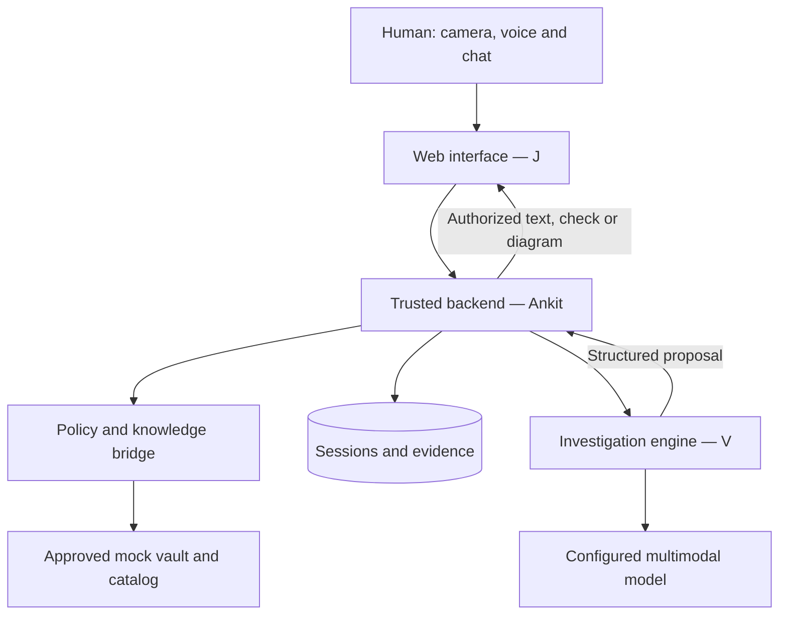

# Mark-1: complete team implementation specification

Version 2.0 | 10 November 2026 | Visual investigation baseline.

Generated from the split specifications; edit those files first. Companion contracts and backlog are in `Mark1-Team-Spec/`.

---

<!-- 00-START-HERE.md -->

# Mark-1: visual investigation implementation pack

Version 2.0 | 10 November 2026 (India) | Proposed specification; implementation and product gates unverified.

## Product baseline

Mark-1 is a human-in-the-loop visual investigation assistant. The camera is its eye; the AI investigates; a permission-enforcing bridge supplies applicable approved machine knowledge from an M-Files-like vault. The agent requests useful views and contextual answers, retrieves evidence, explains machine flow using a cutaway diagram, highlights a suspected subsystem, and proposes permitted checks. The human controls the camera and performs every physical action.

R0 must demonstrate this investigation experience, not merely a sequential checklist: one fictional laptop model/configuration, no-power symptom, selected camera snapshots, voice/chat, a source-backed 2D cutaway and a small branching scenario set. Real M-Files access remains prohibited in this repository; use the local mock and synthetic data.

## Read and implement

1. `01-PRODUCT-AND-ARCHITECTURE.md`: scope, experience, trust and state model.
2. `02-OWNERSHIP-AND-HANDOFFS.md`: owners, integration and dependencies.
3. `03-A-BACKEND-SPEC.md`: Ankit's independently buildable backend package.
4. `04-V-AI-SPEC.md`: Viditya's investigator, perception and knowledge package.
5. `05-J-FRONTEND-SPEC.md`: J's camera, chat, speech and diagram package.
6. `06-CONTRACTS.md` and `contracts/`: normative v2 operations, schemas, fixtures and checks.
7. `07-VALIDATION-AND-RELEASE.md`: evaluation and evidence gates.
8. `08-DELIVERY-AND-OPERATIONS.md`, `09-BACKLOG.csv`: delivery order and tickets.
9. `10-ELEPHANT-GOLDFISH-REVIEW.md`, `11-GATE-AND-DECISION-REGISTER.md`: review status and decisions.
10. [12-ARCHITECTURE-EXPLAINED-AND-OPEN-GAPS.md](12-ARCHITECTURE-EXPLAINED-AND-OPEN-GAPS.md): architecture diagram, design patterns and open refinements before implementation freeze.

Split files and machine-readable contracts are authoritative. The combined sibling document is a distribution copy assembled from these Markdown files.

| Owner | Implements | Independent development substitute |
| --- | --- | --- |
| A - Ankit | API/auth, bridge/policy, state/evidence, media boundary, publication, deployment/integration | Deterministic engine stub and synthetic server test catalog |
| V - Viditya | Perception, investigation, retrieval, knowledge/diagram authoring, model adapter/evaluation | Frozen requests and AI-owned provider fakes |
| J | Phone UI, capture/chat, speech UX, diagram renderer, recovery/accessibility | Frozen API fixtures |

A can complete the local backend without V's engine or J's screens. Integrated experience requires both. V/J contract review is needed before branches rely on the frozen interface. A does not implement their modules by default.

## Change from v1

Camera requests, dialogue, voice and cutaway explanations move into R0. Synthetic advisory suspected-subsystem explanations are enabled; real-world diagnosis remains separately gated. Streaming video, tracked AR, learning and autonomy remain later increments. Contract 2.0 and `/v2` replace the v1 design. No deployed migration, independent v2 review or passed product gate is claimed.

---

<!-- 01-PRODUCT-AND-ARCHITECTURE.md -->

# Product and architecture: visual investigation

Version 2.0 | 10 November 2026

## Practical experience

The user opens a phone web app beside a supported device and describes the symptom. The agent inspects a selected frame, requests the label or a better angle, retrieves applicable knowledge, asks contextual questions and chooses further evidence. Text/optional speech, camera preview and a separate 2D flow/cutaway panel explain the suspected subsystem. It requests an approved external check, waits for a human observation, then continues or escalates.

Example R0 path: identify fictional DEMO-LAPTOP/DEMO-C1; confirm identity; hazard preflight; request a wider external view; ask about a supplied fictional indicator; show an approved power-flow diagram with a suspected input-stage location; offer a supported check or escalate. Branch on unreadable views, uncertainty and conflicting evidence. Camera appearance alone never establishes an internal electrical failure.

| Release | Required experience | Boundary |
| --- | --- | --- |
| R0 visual demo | One fictional model/no-power scenario set; camera follow-up; contextual questions; chat; speech input/output with visible fallback; source-backed 2D cutaway and advisory suspected subsystem; external checks and durable history | Synthetic/generated material; no customer operational use; failure handling demonstrated |
| R1 supervised pilot | Technically approved real family/catalog and evaluated investigator in an authorized environment | G0-G3; real diagnostic explanation additionally G4; real vault prohibited under current repo rules |
| R2 expansion | Streaming, tracked AR, more equipment, verified-repair learning, separately evaluated | No automatic autonomy or universal diagnosis |

No disassembly, battery handling, energized probing, mains measurement, flashing, bypass or remote execution. View requests must not ask for internal access, moving running machinery or another unapproved operation. Machine-specific behavior is catalog metadata, not hardcoded policy.

## Loop

1. Authenticate, select supported workflow and describe symptom.
2. Capture/upload a snapshot or enter a label. Before confirmation, only identity-oriented safe view requests are allowed.
3. AI returns exact supported candidates or requests another view; human confirms model/configuration against label.
4. A scopes knowledge/permissions and independently requires hazard preflight. CLEAR is a human report, not guarantee; HAZARD/UNSURE stops.
5. V receives authorized catalog, selected frames, accepted evidence and recent messages; proposes a view, question, explanation, check or escalation.
6. A validates and resolves canonical text/diagram. J displays one active interaction; voice reads that same authorized text.
7. Save human response before the next inference. Free chat never silently becomes a confirmed prerequisite. End on human-reported outcome or escalation.

## Architecture and trust

Phone web client -> A authenticated HTTP API -> A state/policy/mock knowledge bridge -> V investigation module -> configured multimodal provider. One backend deployment and transactional store; no mandatory microservices, agent swarm, vector service or live stream. A supplies a bounded authorized catalog; V ranks within it. A may refresh knowledge on a subsequent context-bound turn. Model tools are read-only; writes/confirmations are app-only.

A owns readiness/policy; V proposes IDs/source/evidence bindings, not instructions or approvals; J renders A's output, never direct model/vault content. Bridge checks user and configured agent access, exact applicability, current lifecycle and hidden restrictions. Missing policy ->UNKNOWN. Withdrawal/obsolescence/supersession revokes with no historical approved fallback; a Draft successor alone does not revoke valid content.

## Language and evidence

R0 uses context-selected approved view/question/explanation templates. Free text and corrected voice transcripts are bounded untrusted human reports. An unknown question triggers clarification/escalation. Composed canonical explanations describe flow, evidence and suspected location without asserting verified cause or calibrated probability. Arbitrary model prose is not displayed/spoken; expanding generative language requires a new evaluated contract.

Distinguish HUMAN_REPORT, HUMAN_CONFIRMED_OBSERVATION and IMAGE_OBSERVATION evidence. Image interpretations remain model interpretations. OBSERVED/REPORTED/SUSPECTED/UNKNOWN highlights retain provenance; A evaluates authored claim rules, not merely source membership. Conflicting evidence produces uncertainty. A completion click never verifies repair.

## Cutaway ('x-ray')

An approved schematic/cutaway has immutable version, component node/edge IDs, source references and 2D coordinates expressed as integer 0..1000, normalized by renderer. It represents authored machine structure, not camera penetration or measured current. Highlights reference catalog nodes and display evidence/uncertainty. No model-supplied coordinates/HTML/SVG/URLs or invented geometry. Missing applicable diagram ->explicit unavailable/text explanation. Separate panel needs no camera tracking; moving aligned overlays are deferred.

## State, freshness and interruptions

Statuses: AWAITING_IDENTITY, EVALUATING, AWAITING_VIEW, AWAITING_ANSWER, EXPLAINING, READY, RECORD_PENDING, BLOCKED, UNKNOWN, ESCALATED, COMPLETED. READY carries one check. The three new interaction states carry exactly one VIEW/QUESTION/EXPLANATION respectively. Other states have neither. Unconfirmed AWAITING_VIEW permits IDENTITY purpose only. EVALUATING runs IDENTIFY or INVESTIGATE; GET never initiates inference. Terminal BLOCKED/UNKNOWN/ESCALATED/COMPLETED never revive; restart after UNKNOWN means a new session.

Reauthorize every served interaction/check and submitted result. Foreground refresh every five seconds, lease <=15 seconds. Hide prompts/highlights and cancel queued/playing speech on expiry, failed refresh, background/offline, stop or changed context. Refresh on focus before restoring. Already heard speech cannot be recalled. Historical text is visibly non-actionable and never spoken as current guidance. Retry returns immutable command effect plus fresh current state, never old instructional snapshots.

## Media, voice and budgets

Local live preview; transmit explicit user-selected JPEG/PNG frames, not continuous video. Max 10 MiB each, three selected frames/inference; server verifies signature/type/dimensions, rejects bombs and strips metadata. A-01 freezes pixel/downsampling limits. No raw audio/video persistence or arbitrary runtime document uploads.

Push-to-talk yields an editable transcript with explicit Send; backend accepts text, not audio. J owns browser speech adapter and typed/text fallback. Browser speech processing/consent must be documented; adding hosted speech requires new rights/API design. Speak only the current authorized text, with mute/stop.

Chat/transcripts <=2000 characters; newest 20 relevant human messages per inference, explicit omitted count. Full authoritative observations remain available to backend prerequisites. Provisional per-inference caps: 8 model turns, 16 scoped calls, 60 seconds; per-session 24 inferences, three unsuccessful captures per view template. Atomic enforcement, retries within original budgets, no repeats without new evidence. Freeze measured limits A-01; exhaustion escalates.

---

<!-- 02-OWNERSHIP-AND-HANDOFFS.md -->

# Ownership, dependencies and handoffs

Version 2.0. Every file/artifact/ticket has one implementation owner. Reviews are collaborative; transfer records paths, interval and replacement owner. Never create competing APIs, providers, catalog stores or workflow databases.

| Area / target path | Sole owner | Consumer/reviewer |
| --- | --- | --- |
| `mark1/server/**` | A | V/J boundary review |
| `mark1/contracts/**` and spec contracts | A | V/J before freeze |
| `mark1/tests/integration/**`, `mark1/tests/security/**` | A | Relevant owner |
| `mark1/ai/**`, prompts/provider/retrieval, AI tests/evals | V | A/SME |
| `mark1/knowledge/**`, templates, diagrams/graph, sources/scenario labels | V authors | A publishes; SME approves real content |
| `mark1/web/**`, camera/chat/speech/diagram renderer/UI tests | J | A integration, V content UX |
| Mark-1 root dependencies/locks/CI/deployment | A | V requests AI dependencies; J owns web lockfile |
| Product/contracts/gate docs | A | Affected owners |
| AI/data/model cards | V | A/SME |
| UX/accessibility docs | J | A/V |

Target paths are not existing implementation claims. A-01 reconciles nested `mark1/mark1/**` skeleton with one Python package/import layout. Do not create two package roots. Preserve `lantern/**` reference POC without modification. Reuse patterns with regressions, not inherited trust; machine behavior stays in metadata.

## Independent work

A owns `server/testing/engine_stub.py` and synthetic server-only test catalog. V owns `ai/tests/fakes.py` and production knowledge authoring. J uses A's all-state fixtures. Shared fixtures are canonical; these doubles are not competing production engines/catalogs.

A can complete local API/auth/state/bridge/evidence/media/interaction validation without V/J. Live AI integration needs V; full phone UX needs J; pilot content needs V+SME/rights. Contract freeze needs their review, not completed modules. Label substituted demos truthfully.

## Handoffs and changes

A -> J: public API, auth/demo setup, all states/errors, command reconciliation, media/speech rules. A -> V: hashed immutable request, scoped catalog/opaque media, budgets/cancellation and strict proposal schema. V -> A: typed proposals, reviewed sources/templates/diagram, versioned model/prompts/evaluation. V -> J only through A: canonical text, labels/graph IDs. J -> A: API-fixture/mobile/speech/accessibility evidence and failing payloads.

A edits contract/schema/fixtures first with compatibility/migration and consumer reviews. 2.0 `/v2` is breaking. Do not implement against unmerged drafts. V authors immutable catalog; A publishes lifecycle; J never copies applicability policy. Short branches `a/<ticket>`, `v/<ticket>`, `j/<ticket>`; merge contracts -> modules -> integration -> evidence. A owns tags/shared configuration. Actual GitHub handles needed before CODEOWNERS/branch rules. No messages/issues/deployments are created by this document.

---

<!-- 03-A-BACKEND-SPEC.md -->

# A - Ankit: trusted backend package

Version 2.0. Complete the local backend against a deterministic engine, independent of V/J. Own API/contracts, authentication, state, bridge/policy, publication, media/evidence and integration. Do not implement V's investigator/prompts/production diagram data or J's UI.

| Ticket | Deliverable | Observable acceptance |
| --- | --- | --- |
| A-01 | Baseline/decisions, single package layout, isolated reproducible runtime | Old/new scope reconciled; auth/limits selected; clean baseline recorded |
| A-02 | v2 contracts, engine stub, all-state fixtures, server test catalog | Full view/question/explanation/check path without real AI/UI; V/J review before freeze |
| A-03 | Transactional sessions/auth/event/command ledger | Actor/tenant isolation, stale/concurrent tabs and restart reconciliation |
| A-04 | Mock knowledge bridge, lifecycle and catalog publication | User+agent permission, exact applicability, withdrawal and hidden restrictions fail closed |
| A-05 | Messages, answers, view responses, explanation acknowledgements and observations | Exactly one effect per retry; no inference before durable save; chat cannot satisfy check prerequisites |
| A-06 | Media/transcript/context/hash/budget boundary | Session-owned frames; no raw audio/video; edited transcript stored as human report |
| A-07 | Independent interaction/claim/diagram validator and preflight | Unknown IDs, forged evidence, unsupported claims, stale diagrams and model prose rejected |
| A-08 | Integrate real V/J with full regression matrix | Camera -> scoped knowledge -> question -> cutaway -> check -> durable outcome |
| A-09 | Local runbook and pilot hardening | Reproducible stub demo, backup/restore, kill switch, retention/deletion evidence |

## Storage/state

One transactional database: sessions; append-only events; observations; messages; view attempts/responses; images; catalog/lifecycle/rights/approvals; inference runs; interactions; idempotency commands. Opaque IDs still require scope authorization. Bind inference to revision, identity, catalog, frame/transcript hashes, accepted evidence, model/prompt versions. Persist human command/event/revision atomically before inference. Image storage alone does not advance investigation; view-response commits linkage. An image receipt is not physical observation evidence.

Only one current inference. User input cancels/invalidates old inference/output before reevaluation. Restart reconciles persisted jobs or yields controlled UNKNOWN. Stop/hazard overrides normal output including pending writes; no write ->no next instruction. External authoritative evidence store, if later required, keeps RECORD_PENDING until its acknowledgement; local commit is not external success. No distributed outbox needed for R0 local storage.

## Bridge/publication

Validate permissions/lifecycle at publication, serving, submission and replay. Only approved source/graph/templates within asset/config/workflow scope. Resolve template IDs to canonical text. Claim rules bind required durable observation/value, required provenance and uncertainty label; evidence membership alone is insufficient. Real diagnosis disabled until G4. R0 synthetic suspected subsystem is visibly advisory.

Reject duplicate IDs/versions, prerequisite cycles/invalid values, dangling graph edges, foreign component references, invalid positions, missing sources/rights/approvals and undeclared claims. Physical/view/question investigation after identity requires preflight CLEAR. Pre-identity views are IDENTITY-purpose safe framing only. Missing diagram yields explicit unavailable/text explanation; missing safety knowledge blocks. Preserve draft-vs-withdrawal distinction and no obsolete fallback.

## Commands/errors

Mutations require Idempotency-Key and expected_revision; create omits revision. Scope keys tenant+actor+session+operation (creation tenant+actor+operation); hash canonical payload. Authenticate/authorize before deduplication, then deduplicate legitimate retries before stale checks. Same key/different payload or fresh stale command ->409. Transactional compare-and-update prevents double effect. Replay returns original command headers plus fresh current Session; Session.receipt stays latest command. Pending never has durable record ID. No historic instruction snapshots.

401 unauthenticated; 403 unauthorized; 404 absent/inaccessible; 409 conflict; 413 size; 415 media; 422 request; 429 limits; 503 dependency unavailable. Restriction yields BLOCKED, policy unavailable UNKNOWN, both without actionable output. Errors suppress guidance/protected details. Truthful pending/UNKNOWN on storage uncertainty, never false saved/completed.

## Completion boundary

Local milestone: API, stub, synthetic test catalog, contract and isolation/policy/media/retry/recovery checks, startup instructions and scripted HTTP journey. No model key/frontend/SME needed for this milestone. V production knowledge/AI, J speech/camera UI and real pilot permissions remain separate handoffs. A test catalog is never production technical approval.

## Implementation evidence - 11 November 2026

The local backend is implemented in nested `mark1/server/**` relative to the outer Mark-1 project directory. See [baseline/decisions](../../product/baseline-and-decisions.md) and [operations/consumer handoff](../../product/operations.md). A-01..A-07 have author-run local evidence; V/J reviews and contract freeze are not claimed. A-08 real module integration and A-09 pilot acceptance remain pending. No V-owned production engine/catalog or J-owned UI has been implemented by A.

---

<!-- 04-V-AI-SPEC.md -->

# V - Viditya: investigator and knowledge package

Version 2.0. Own perception, investigation strategy, scoped retrieval, provider, knowledge/diagram authoring and evaluation. No workflow writes, permission grants or direct instructions to J.

| Ticket | Deliverable | Acceptance |
| --- | --- | --- |
| V-01 | Fictional no-power catalog: preflight/checks, views/questions/explanations, diagrams, labeled scenarios | Versioned IDs, applicability, sources/rights/approval fields, external-only scope |
| V-02 | Identity/frame perception | Glare/crop/wrong-valid/unknown handling; no auto-confirmation or invented serial; frame evidence binding |
| V-03 | Read-only scoped retrieval | Only A-provided subset; missing/conflicting coverage escalates |
| V-04 | Investigation loop | Useful evidence requests, contextual answers, contradiction/no-progress handling |
| V-05 | Provider adapter/parsing/cancellation/fakes | Structured output; retries within original deadlines/budgets; no silent fallback |
| V-06 | Flow/cutaway and advisory explanation selection | Approved components/template, evidence-for/missing evidence, SUSPECTED label |
| V-07 | Held-out evaluation/model/data cards | Denominators, errors, useful camera requests, grounding, escalation, latency/cost |
| V-08 | Real-family/diagnostic pilot proposal | SME-reviewed content, independent evaluation and G4 gate |

## Port and strategy

Implement `propose(request) -> EngineProposal` with cancellation. Modes IDENTIFY/INVESTIGATE. Kinds IDENTITY_CANDIDATES, REQUEST_VIEW, ASK_QUESTION, PROPOSE_CHECK, ASK_OBSERVATION, EXPLAIN, ESCALATE. Return IDs/source/evidence bindings only; no arbitrary instruction/speech, URL, SVG or database mutation. A owns schema and authorization.

IDENTIFY: supported candidates, approved identity-view request or escalation. INVESTIGATE: choose next useful view, question, check, explanation or escalation from accepted evidence and missing information. Free user text can motivate a structured confirmation but never satisfy a physical prerequisite. Image interpretations remain interpretations. Avoid repeated requests without new evidence; max attempts/session limits enforced by A.

## Knowledge/diagram authoring

Version safe label/overview/external-component views, approved prompts, scope and stop wording. Questions have enum options and references. Explanation templates have canonical factual text, required observation/value claim rules, allowed highlight nodes and advisory labels. A publishes; SME signs real technical content. Synthetic content/source hashes match fixture text and approval IDs are visibly demo-only.

A versioned 2D component graph carries integer normalized coordinates 0..1000, canonical labels/directed flow edges and sources. It is authored structure, not measured current or internal camera vision. Missing applicable diagram cannot be fabricated. V authors graph; J renders; A validates/publishes.

Provide branching synthetic scenarios: distinguishable external observation, unreadable identity, absent diagram, contradictory report, unsupported view and insufficient evidence. R0 exposes authored synthetic suspected-subsystem explanation; real causal claims remain G4-controlled. No online learning, training gym or autonomy promotion.

## Security/evaluation

OCR/documents/chat/transcripts are untrusted data. Never follow embedded instructions/fetch URLs; tools read-only and ID-scoped. A supplies cleared opaque media; no tenant-wide search or direct vault/client-model channel. Provider refusal/invalid response/budget exhaustion returns handled failure/escalation.

Freeze held-out device/session/scenario splits before tuning. Compare static approved checklist and deterministic next-check baseline. Report raw exact identity, wrong-valid candidates, human corrections/final errors, refusal/coverage, useful/unsafe/redundant camera requests, evidence-grounded explanations, correct diagram/node mapping, contradiction/escalation, turns, median/tail latency and actual costs. Include all failed/excluded attempts. Independent SME reference labels required for real correctness claims. Never present confidence as calibrated probability without evidence.

---

<!-- 05-J-FRONTEND-SPEC.md -->

# J - camera, conversation, voice and cutaway frontend

Version 2.0. Own `mark1/web/**` screens/API wrapper/UI tests. Consume A's API/fixtures; no direct model/vault, client policy or copied applicability rules.

| Screen/panel | Behavior |
| --- | --- |
| Start/identity | Demo label/supported symptom; camera capture/retake; manual fallback; explicit model/config physical-label confirmation |
| Investigation camera | Local live preview; canonical request/target/safety text; user-selected snapshot submission; unavailable/unsure response |
| Conversation | Bounded chat; approved assistant text; enum questions; sources; distinguish report from confirmed observation |
| Voice | Push-to-talk ->editable transcript ->explicit Send; optional current-text read-aloud; mute/stop and typed fallback |
| Cutaway | Separate 2D flow panel, source/version, canonical labels, suspected/evidence highlight; 'diagram, not internal camera observation' |
| Check/preflight | One authorized check, safety/stop conditions, enum answer and human confirmation |
| Recovery/summary | Pending vs saved, command reconciliation, human-reported outcome and historical evidence |

No continuous video upload or tracked AR in R0. Missing camera/speech/diagram has explicit fallback; manual identity does not count as a supplied investigative image.

| Ticket | Deliverable | Evidence |
| --- | --- | --- |
| J-01 | Wireframes/all-state inventory | Phone journey and every pending/error/terminal state |
| J-02 | Capture/identity/view response | Denied permission, retake, cancel/unavailable, explicit send |
| J-03 | Chat/structured answers | Sources, report/confirmation distinction, stale interaction rejection |
| J-04 | Speech adapter UX | Editable transcript, consent, stop/mute, unsupported-browser fallback |
| J-05 | 2D diagram renderer | Correct graph/version/labels and grounded highlight; no invented alignment |
| J-06 | Retry/freshness/local stop | Double tap, lost response, reload, background/resume, speech cancellation |
| J-07 | Summary/mobile/accessibility/integration | Focus/keyboard/screen-reader states; fake/real backend modes |

## State and safety

AWAITING_VIEW shows VIEW; AWAITING_ANSWER shows QUESTION; EXPLAINING shows explanation+Continue; READY shows check/preflight. No readiness inferred from missing fields. Refresh visible active session every five seconds; hide active prompts/highlights and cancel speech on lease expiry <=15 seconds, refresh failure, background/offline or stop. Fetch current state on resume/before submission. Repeat speech only while authorized; no model commentary spoken. Safety text remains visible. Already heard speech cannot be recalled.

Browser speech support/processing varies: test named target mobile browsers and disclose approved processing/consent; typing/text always available. No raw audio upload or secret hosted speech fallback. Speak `interaction.text` or approved check text only. Never let pending ordinary response override local stop. Report hazard/Stop remains available from every active screen, locks immediately offline, cancels speech/capture and reconciles same command key.

Stable key per intentional command; exact retry preserves key/payload; changed answer is a new action. Minimal pending-key persistence only by A-agreed scope/expiry, clear on receipt/logout. Never persist raw images/audio/sources/full sessions in browser storage or log private payloads. Render text as text; graph accepts validated nodes/edges, never arbitrary HTML/SVG/URLs. Source/history views are labeled historical and cannot replay old physical guidance as current.

---

<!-- 06-CONTRACTS.md -->

# Contract 2.0: API and visual investigation port

A is sole editor; V/J review before freeze. Breaking change: `/v2`, interaction states, conversational/media responses, context and diagram/template catalog. No deployed migration or v1 compatibility is claimed. Files here are canonical until A-02 publishes the chosen runtime location; do not hand-maintain duplicate copies.

## Common rules

Authenticated same-origin API; HTTPS for pilot. A-01 selected server-verified opaque bearer tokens for the local demo; canonical OpenAPI records `bearerAuth`. Cookie authentication is not implemented. Any later cookie deployment requires secure/HttpOnly/SameSite cookies and CSRF protection. Actor/tenant come from auth. Every ID is scope-checked. UTC RFC3339; integer revisions; unknown mutation fields rejected. All mutations require Idempotency-Key; session mutations expected_revision. Error/receipt semantics in A's spec apply to new operations.

| Method/path (prefix `/v2/sessions`) | Allowed state | Effect |
| --- | --- | --- |
| POST root | No session | AWAITING_IDENTITY |
| GET /{id}, /{id}/events, /{id}/commands/{command_id} | Any authorized | Current revalidated state/history/receipt; no inference |
| POST /{id}/images | AWAITING_IDENTITY, AWAITING_VIEW, READY | Store sanitized image; purpose identity/investigation/observation matches state; no inference |
| POST /{id}/identity-candidates | AWAITING_IDENTITY | IDENTIFY ->candidates or identity view, EVALUATING meanwhile |
| POST /{id}/identity-confirmation | AWAITING_IDENTITY | Human identity ->EVALUATING ->independent preflight |
| POST /{id}/view-responses | AWAITING_VIEW | IMAGE with image ID, UNAVAILABLE or UNSURE; persist ->EVALUATING; identity views run IDENTIFY |
| POST /{id}/answers | AWAITING_ANSWER | Active interaction/question/version+enum answer; persist ->EVALUATING |
| POST /{id}/messages | AWAITING_IDENTITY, EVALUATING, AWAITING_VIEW, AWAITING_ANSWER, EXPLAINING, READY | Persist CHAT/VOICE_TRANSCRIPT human report; invalidate prior inference/output ->EVALUATING; IDENTIFY if unconfirmed, otherwise INVESTIGATE; preflight still enforced |
| POST /{id}/explanation-acks | EXPLAINING | Persist acknowledgement ->EVALUATING; never repair verification |
| POST /{id}/observations | READY | Check/version/value confirmation; pending until durable ->EVALUATING |
| POST /{id}/outcome | READY, EVALUATING, AWAITING_VIEW, AWAITING_ANSWER, EXPLAINING after >=1 durable check observation | No pending write; cancel inference; human RESOLVED ->COMPLETED, UNRESOLVED ->ESCALATED after save |
| POST /{id}/stop or /hazards | Any nonterminal including RECORD_PENDING | Monotonic inhibit/reconcile ->ESCALATED after save; stale revision accepted; key/payload mismatch remains 409 |

Ordinary mutation in RECORD_PENDING/terminal ->409 except authorized same-command replay. Accepted commands have durable event/command records; 202 RECORD_PENDING while required write unresolved. Pending stop may return RECORD_PENDING or UNKNOWN on storage failure with no output, never fabricated saved receipt. Inference result commits only on matching current revision/context. Image upload increments revision but preserves active interaction/check; follow with current-revision response. Conversation can interrupt but never bypass identity/preflight. GET never runs engine.

## Session/interaction

Required `interaction` is null except AWAITING_VIEW/AWAITING_ANSWER/EXPLAINING, which require VIEW/QUESTION/EXPLANATION respectively and no current_check. READY requires current_check, confirmed identity, null interaction and no pending receipt. Unconfirmed AWAITING_VIEW permits identity purpose only. Question/explanation require confirmed identity. Each interaction has ID, template/version, canonical text, exact primary source, current-policy time, expiry, safety/stop fields. VIEW includes purpose/target; QUESTION enum options; EXPLANATION advisory flag, claim/evidence list, optional embedded catalog diagram/highlights. Missing diagram ->null and no highlights. Actual lease order/duration <=15 seconds, ID applicability and claim semantics are runtime validations.

Speech uses current `interaction.text` or check instruction, never extra model audio/prose. Diagram consists of authored nodes/edges, integer normalized positions 0..1000 and exact version/source; no arbitrary external fetch/markup. Historical events remain evidence summaries, not replayable instruction snapshots.

## Catalog, context and proposals

Catalog includes checks, view_templates, question_templates, explanation_templates and diagrams. Every record binds model/config/workflow, source/hash/rights, Approved state and approval record. Questions enum-only; views approved external safe framing. Explanation claim rules bind a required check/version/observation/value and allowed highlight node IDs, with authored SUSPECTED label. Graph node/edge/reference/prerequisite validation is mandatory at publication beyond schema. V authors; A publishes; SME approves real content.

EngineRequest modes IDENTIFY/INVESTIGATE. Include authorized catalog, identity, selected cleared media, durable observations, versions/budgets and required investigation_context: recent human messages, answers, view results, explanation acknowledgements, available evidence IDs, prior interaction template IDs, omitted message count and session counters. Max 20 messages, three frames. Full backend observations remain authoritative even when conversation is truncated. Context contains no raw audio or arbitrary URLs.

Proposal bindings echo contract_version/request_id/session_id/based_on_revision/context_hash. Kinds:

- IDENTITY_CANDIDATES: exact supported candidates, never auto-confirmation.
- REQUEST_VIEW: approved view ID/version and sources; A resolves purpose/target/prompt.
- ASK_QUESTION: question ID/version and sources; A resolves options/wording.
- PROPOSE_CHECK/ASK_OBSERVATION: check ID/version and sources; observation code when applicable.
- EXPLAIN: explanation ID/version, sources, evidence IDs and highlight node IDs. A evaluates authored claim rules and composes canonical explanation; no model-authored diagnosis/instruction text.
- ESCALATE: safe reason enum.

IDENTIFY accepts only candidates/identity view/escalation. INVESTIGATE accepts investigation views/questions/checks/explanations/escalation. A forces preflight independently of model choice. Evidence membership alone cannot justify claims: observation value/provenance/applicability must match. Synthetic R0 suspected subsystem is advisory; real diagnosis requires G4. Unknown user questions can motivate clarification, not invent new permitted physical actions.

## Hash/replay/media

context_hash = SHA-256 of UTF-8 JSON, recursively sorted keys, compact separators, ASCII escapes, no NaN/Infinity, integer numeric inputs, array order preserved. Include mode/workflow_id/confirmed_identity/manual_label/cleared_images/approved_catalog/observations/completed_check_ids/catalog_version/prompt_version/model_config_version/investigation_context. Exclude request/session IDs, revision, deadline, remaining request budget counters and hash; A separately binds these. Session counters inside context are hashed. Image content represented by SHA-256/opaque server handle; no model URL fetch. A records exact bytes; V echoes hash. Absolute UTC deadline plus monotonic elapsed enforcement.

Authenticate/authorize before deduplication, legitimate retry before stale check. Return original X-Command-Id/X-Command-State and fresh current Session; Session.receipt remains latest command. Command receipt endpoint reconciles PENDING ->PERSISTED without duplicate effect. Image receipt separate from physical evidence. Fixed synthetic fixture timestamps/hashes are examples, not current authorizations; fake server must issue fresh leases and binding hashes.

---

<!-- 07-VALIDATION-AND-RELEASE.md -->

# Validation and release gates

Version 2.0. Proposed criteria; no runtime/model/independent-v2-review/pilot/customer result is claimed.

| Test | Owner | Result |
| --- | --- | --- |
| T01 policy/direct HTTP/skipped model | A | No output/check before independent policy/preflight |
| T02 lifecycle/hidden restrictions | A | Withdrawal/obsolete/supersession stops, draft alone does not revoke; protected details hidden |
| T03 scope/auth | A | User+agent access, tenant/asset/source/frame/diagram/evidence mismatch denied |
| T04 receipts/concurrency/restart | A | One effect; stale/replayed command cannot restore old guidance |
| T05 stop/freshness | A backend; J UI | Stop during inference/write; stale stop; expiry/offline/background cancel output/speech |
| T06 model failures/injection/budgets | V engine; A boundary | No unsafe tool/write/URL/prose or unbounded loop |
| T07 perception | V | Raw/post-human identity, refusal/coverage and wrong-valid errors separate |
| T08 investigation | V | Useful views/questions, blur/unsupported/contradiction and no-progress handling |
| T09 evidence/explanation/diagram | V authoring; A runtime | Source/version/node/claim rules; missing evidence/diagram; advisory label |
| T10 voice/chat/mobile/accessibility | J | Edited transcript, typing fallback, canonical speech, no stale playback |
| T11 integrated journey | A | Image ->retrieval ->question ->cutaway ->check ->durable outcome |
| T12 operations | A | Backup/restore, kill switch, retention/deletion/restart |
| T13 real diagnosis | V with independent SME | Predeclared held-out causal/next-check/escalation criteria met |

Each test file has one owner; multi-module rows mean separate owner tests plus A integration. Schema validity is not runtime policy/semantic correctness.

| Gate | Evidence |
| --- | --- |
| G0 scope/rights/contracts | One family/symptom, owner-reviewed frozen v2, technical/source owner, provider/media permissions and boundaries |
| G1 controls | T01-T06 backend; no critical bypass/false saved result |
| G2 investigator/perception | >=100 held-out images, zero wrong final accepted identity in set, >=90% usable readable-supported coverage; raw errors separate; investigator criteria below |
| G3 supervised environment | Auth/scope, approved sources/data terms, retention/recovery, T10-T12; named customer/admin/SME/independent acceptance |
| G4 real diagnosis | Explicit enablement, independent labels, predeclared sample/error criteria and T13; calibrated claims require evidence |
| G5 value/cost | >=30 matched task pairs, proposed >=20% lower median time without observed worse errors/tail/supervisor effort; total cost/uncertainty |
| G6 commercial | Five interviews across >=3 organizations, two independent commitments, one actual paying customer, measured economics |

R0: frozen artifacts, integrated synthetic visual investigation, deterministic controls and truthful labels. Synthetic advisory claims do not close G4. R1 requires G0-G3; real diagnosis also G4. Current repository real-vault/customer-data prohibition remains; pilot needs separately authorized environment/rule review. No gate grants broad rollout or physical autonomy.

## Evaluation protocol

Freeze held-out sessions before tuning; split by device/session/source, avoid near duplicates. Include indistinguishable causes, glare/crop, wrong-valid ID, absent diagram, contradictory reports, unsupported angle, injection, voice correction and exhausted views. Compare static approved checklist and deterministic next-check baseline. Predeclare case counts, useful-view/task/escalation labels, diagram criteria and latency/cost budget; until recorded, investigator evaluation is UNKNOWN.

Report raw extraction, human corrections and accepted identity separately; confirmation is not abstention. Measure useful/unsafe/redundant camera requests, grounding, correct nodes, contradiction/escalation, turns to evidence, completion time, refusal/coverage, median/tail latency and actual costs; include excluded/failed attempts. Require zero accepted unsafe/out-of-catalog actions and zero ungrounded displayed fault claims in frozen set. Finite sample does not prove zero real-world error. Camera request success means safe/relevant evidence gain or appropriate refusal, not just plausible wording.

Evidence binds commit/environment, contract/catalog/diagram/model/prompt versions, manifest/denominators, failures and independent reviewer. Named external roles required before pilot. Rerun impacted tests on provider/content/policy changes; v1 review does not transfer to v2.

---

<!-- 08-DELIVERY-AND-OPERATIONS.md -->

# Delivery and operations

Version 2.0. Capacity/hours/access unknown; no calendar promise. A can build local backend in continuous tested checkpoints; full product requires V/J handoffs.

## Sequence

1. A-01 baseline: scope/package layout, isolated dependencies, demo auth, media/budget limits, target browsers and open pilot blockers.
2. A-02 contracts/stub; V-01 synthetic knowledge/diagram; J-01 wireframes. Review/freeze same v2 payloads before branches consume them.
3. Independently A-03..A-07 against stub; V-02..V-06 against requests; J-02..J-06 against API fixtures.
4. A-08 integration replaces doubles, runs full experience/failure matrix; A-09 local runbook/recovery, J-07 acceptance.
5. V-07 evaluation; remain synthetic R0. V-08/pilot require source rights/SME/environment; real diagnosis separately gated.

Old 10-day plan/v1 effort ranges are superseded. Confirm each owner's hours and separately estimate implementation/evaluation/integration. A critical path includes auth/policy/persistence/integration; reduce scope or explicitly transfer a whole area if capacity fails, never overlapping writers.

## Stack and configuration

Prefer existing Python/FastAPI direction and SQLite. J's React/Vite/TypeScript proposal is frozen with J at A-01, not assumed installed. A reconciles nested package skeleton. V selects configurable multimodal provider with measured evaluation; no stale model ID/free price assumption. Browser speech adapter with typed fallback first; hosted speech/live transport needs separate data/API design.

A configures demo/pilot, enabled workflow, contract/catalog/diagram, synthetic/real advisory flags, provider/model/prompt, budgets/files, auth/retention/kill switch. Secrets server-only .env/config. Logs contain correlation/state/version/latency/counter/rejection/pending-age/cost, not raw images/transcripts/serials/documents. V owns AI metrics; J sanitized UI failures through A.

## Privacy and incidents

R0 fictional/generated data. Separate permissions for source display, provider image/source transmission, evaluation, retention/backups and training. Browser speech may transmit audio depending on platform: disclose approved processing/consent or disable input with typing available. No silent fallback. Deletion covers derived copies and backup expiry. No real M-Files/MCP/customer access introduced by v2.

Operator stops, J hides prompts/highlights/cancels speech locally, A disables workflow. Reconcile stable command keys before retry; never manually mark saved. Owners fix own modules and rerun affected gates. Restore compatible schema/catalog/model without reviving revoked authority. Operators must stop on lost connectivity/current authorization; spoken content cannot be recalled.

Streaming needs transport/backpressure/privacy/budgets; tracked AR needs geometry/pose/alignment evaluation; learning needs independent labels/rights/offline promotion controls; more equipment needs catalog/evaluation. None is prerequisite for R0 visual investigation.

---

<!-- 10-ELEPHANT-GOLDFISH-REVIEW.md -->

# Review status and v2 change record

Version 2.0 | 10 November 2026

V1 recorded independent reviews of the controlled-check design. That acceptance does not apply to v2. No independent v2 review has been performed in this revision; no product gate is closed.

Fresh review must cover new view/question/explanation states, conversation/media commands, context hashing, diagram/claim rules, voice as an authorized output, safe camera framing, synthetic advisory versus real G4 diagnosis, and preservation of lifecycle/idempotency/hidden-restriction/pending-write controls.

A reviews schema/OpenAPI/references/hash/state/replay; V evidence/claim semantics, camera utility and contradiction; J UI/speech/capture/diagram/recovery. Independent reviewer assesses trust/feasibility after owner reviews; SME approves real technical knowledge.

Run `python contracts/validate-contracts.py` and `python contracts/validate-hashes.py` from this pack (or repository-relative equivalents). Record actual environment/output; do not copy historical pass counts. These validate artifacts only, not application/model/repair correctness. This filename is retained for continuity; no fresh multi-agent review is claimed.

## Artifact verification - 10 November 2026

Executed with Python 3.13.7 and jsonschema 4.26.0 in a temporary validation installation:

- 92 positive/negative schema fixture checks passed, including public Session reference resolution.
- Fictional source hash, catalog/graph references, v2 API structure, scenario references and all 28 single-owner backlog dependencies passed.
- Two canonical-context golden hashes and embedded/standalone catalog-schema equality passed.
- Combined specification matched all 11 split Markdown documents; Git whitespace checks passed.

This is author-run artifact verification, not an independent design review or runtime/model/pilot test. Product gate statuses remain unchanged.

---

<!-- 11-GATE-AND-DECISION-REGISTER.md -->

# Decision and evidence register

Version 2.0 | 10 November 2026

| ID | Decision | Owner | Status |
| --- | --- | --- | --- |
| D01 | Camera-led selected snapshots, voice/chat, separate 2D cutaway in R0 | A | User-accepted direction, implementation pending |
| D02 | AI investigates; bridge supplies knowledge; backend authorizes; human acts | A | Baseline |
| D03 | A backend/contracts; V investigator/knowledge; J UI/speech/renderer | A | Baseline, no transfer |
| D04 | Fictional laptop/config, no-power scenario set, external-only | A, V content | R0 scope |
| D05 | Contract 2.0 /v2 | A | Proposed; V/J review/freeze pending |
| D06 | Synthetic suspected subsystem R0; real diagnosis G4 | A | Baseline |
| D07 | Single Python layout/framework/locked dependencies | A | Local nested Python package/runtime implemented; see backend decision record |
| D08 | Auth/pixel limits/budgets/target browser speech | A with V/J | Demo bearer auth/media/budgets chosen; J browser/speech decision open |
| D09 | Real family/SME/source/media/provider rights/retention | A; V content | Open; blocks pilot, not build |
| D10 | Real vault/customer data prohibited here | A | Standing; mock only |
| D11 | Hours/GitHub handles/hosting | A | Open; no dates/accounts inferred |
| D12 | Held-out investigation/real diagnosis criteria | V; A release | Open before evaluation |
| D13 | Streaming/tracked AR/learning/autonomy | A | Deferred |

| Gate | Status | Sign-off |
| --- | --- | --- |
| G0 | UNKNOWN: owner freeze/rights not accepted | A + V/J contract review + relevant rights/SME |
| G1 | UNKNOWN: author-run local backend evidence available; cross-review/acceptance pending | A + reviewer |
| G2 | UNKNOWN: investigator/photo benchmark absent | V + A/SME/independent |
| G3 | UNKNOWN: pilot environment absent | A + customer/admin/SME/independent |
| G4 | REAL DIAGNOSIS DISABLED; synthetic advisory only | V evidence; A/SME/independent release |
| G5 | UNKNOWN: value study absent | A + customer/SME |
| G6 | UNKNOWN: buyer evidence absent | A + authorized buyer |

Decision template: ID/date/owner/problem/options/chosen behavior/paths/schema diff/consumer review/verification/rollback/version. Transfer adds replacement owner/interval.

Evidence template: gate/test, commit/environment, contract/catalog/diagram/model/prompt, manifest/predeclared criteria, date/command, sanitized results, denominator/exclusions/failures/uncertainty, reviewer/limitations/retest. No old green status transfers without applicability evidence.

Release checklist: owner/independent review, required gates, rights by purpose, auth/scope/kill switch, no false saved result, source/diagram revocation, speech/offline controls, backup/deletion/recovery, visible demo/advisory labels and named acceptance. Artifact pass is not product pass.

Main risks: wrong identity (V perception/A binding), invented diagnosis (V templates/A claim rules), stale speech (A lease/J cancellation), duplicate evidence (A ledger/J pending), data leakage (A scopes/V injection), misleading cutaway (V graph/J labels), A bottleneck (early fixtures/capacity scope).

---

<!-- 12-ARCHITECTURE-EXPLAINED-AND-OPEN-GAPS.md -->

# Architecture explained and open gaps

10 November 2026 | Review note for specification 2.0

This note explains the architecture and records refinements needed before the affected contracts are frozen. It does not amend the current JSON schemas, implement the proposed fixes or close release gates. The behavior contracts remain in [06-CONTRACTS.md](06-CONTRACTS.md).

## Architecture

Mark-1 follows a **modular monolith with an explicit AI trust boundary**: one backend deployment, separate backend and AI modules, one transactional database, and a phone-friendly web client.

The diagram shows responsibility and data access, not separate deployed services. Policy and the bridge belong to A's backend. V receives only A's authorized knowledge subset and cleared media. J never connects directly to a model or vault. R0 uses fictional data and a local mock; real M-Files access remains prohibited in this repository.

| Pattern | Meaning in Mark-1 | Practical benefit |
| --- | --- | --- |
| Modular monolith | Backend and investigator are separate modules in one deployment | Simple deployment with clear ownership |
| Ports and adapters | A calls the defined engine interface; provider details stay in V's adapter | A can develop against a deterministic stub and later integrate V's engine |
| State-machine workflow | Explicit states govern identity, views, questions, explanations, checks, pending writes and stops | Transitions can be validated independently of the model |
| Retrieval-grounded investigation | The investigator selects evidence and next interactions using applicable approved knowledge | Recommendations can be traced to sources and observations |
| Human-in-the-loop control | People confirm identity, report observations and perform physical actions | Model interpretations remain distinct from human confirmations |

This is an agentic loop: **observe -> retrieve -> identify missing evidence -> ask -> reassess**. The model proposes; deterministic backend rules authorize. Model interpretations, human reports and persisted evidence are different types of information. A persisted report does not prove physical truth or a verified repair.

## Open gaps before implementation freeze

The architecture is a useful baseline, but its contracts and implementation still need refinement. The following are open review items, not completed capabilities or silently adopted schema changes.

| ID | Gap in the current baseline | Proposed next change | Implementation owner and review | Evidence needed to close |
| --- | --- | --- | --- | --- |
| AR-01 | `EXPLAIN` requires evidence and a suspected-fault claim, even when the user only wants to understand normal machine flow | Separate flow-only explanation from advisory fault explanation. Flow-only content needs applicable approved sources/diagram, but no causal claim; fault explanations retain claim/evidence rules | A edits contracts; V supplies content semantics; J reviews display | Fixtures accept source-backed flow without a fault claim and reject unsupported causal highlights |
| AR-02 | Frames and evidence IDs exist, but the lifecycle of a model-interpreted visual finding is not fully specified | Define a typed finding linked to frame ID/hash, component when known, uncertainty and provenance. Human confirmation/correction must be a separate event | A owns schema/storage; V perception implementation; J confirmation UX | A finding is traceable to its frame, cannot impersonate a human observation and is invalidated when its supporting context changes |
| AR-03 | Attempt budgets bound loops, but corrections and conflicting reports lack a complete transition/invalidation contract | Specify correction commands, clarification behavior and how dependent claims/check prerequisites are invalidated. Preserve original evidence and append corrections | A owns command/state contract; V clarification strategy; J correction UX | Changing an earlier answer cancels stale inference and removes affected conclusions; unresolved contradiction escalates without invented certainty |
| AR-04 | Browser speech support, processing and cancellation are specified as requirements but unproven on target devices | Select target phone/browser combinations and test edited transcripts, consent, fallback, mute and cancellation under expiry/offline/stop | J implements/tests; A reviews authorization/data boundary | Published browser matrix and demonstrations of text fallback and no stale queued speech |
| AR-05 | Artifact validation has not established runtime security, investigation quality or latency | Build one complete synthetic investigation and its failure branches; then run the held-out evaluation and operational checks | A integration/runtime; V AI evaluation; J experience tests | Version-bound traces, actual latency/cost, failure results and independent review as required by release gates |

AR-01 to AR-03 should be resolved with reviewed contract changes before the affected module work relies on a frozen interface. They can be handled under A-02 with V/J review; A-05/A-07, V-02/V-04/V-06 and J-03/J-05 are downstream consumers. AR-04 maps to J-04/J-06; AR-05 maps to A-08/A-09 and V-07. These IDs are review references, not additional backlog tickets or duplicate owners.

## What the existing checks establish

The recorded 92 schema checks verify positive/negative payload examples. Hash checks verify canonical fixture bytes and schema consistency. Catalog and backlog checks verify selected artifact references and dependencies. They do not establish secure runtime authorization, correct diagnosis, useful camera requests, safe speech behavior or acceptable latency.

Independent v2 review and product gates remain pending. See [validation and release](07-VALIDATION-AND-RELEASE.md) and [the decision register](11-GATE-AND-DECISION-REGISTER.md).

## Recommended implementation direction

Keep the modular monolith, engine port and deterministic backend authority. Resolve the contract gaps above, then demonstrate one complete camera/question/diagram/check journey with durable evidence and handled failures. Add continuous streaming, tracked AR and learning only after the bounded experience has measured results.
