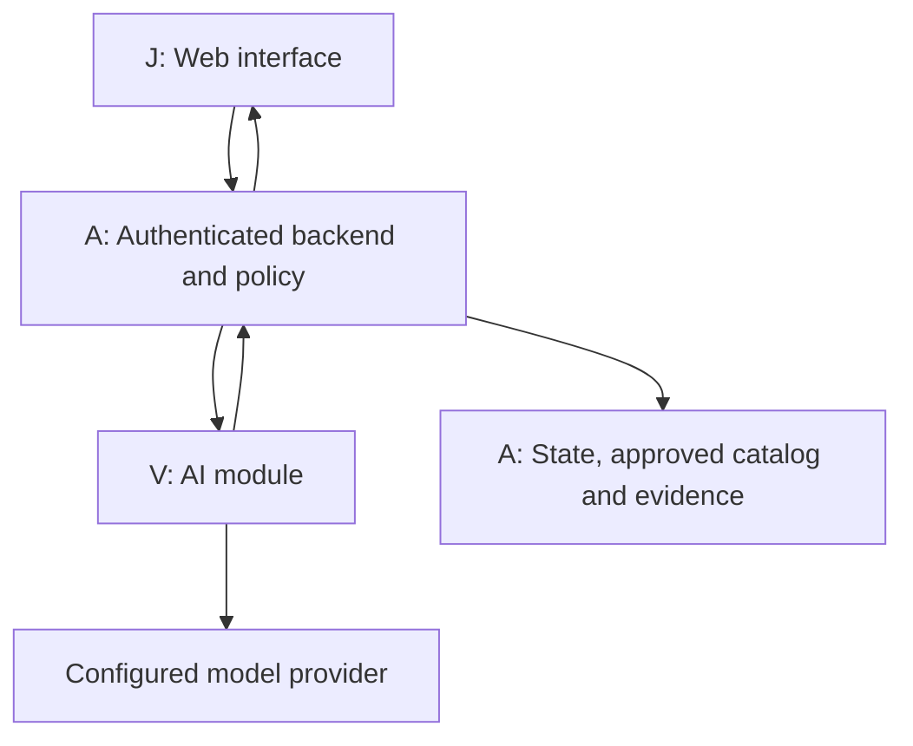

# Product and architecture specification

## Releases and user outcome

| Release | What a user can do | Explicit boundary |
| --- | --- | --- |
| R0 — controlled laptop demonstration | Confirm laptop identity, describe no-power symptom, record observations, follow source-backed allowlisted external checks, save session record | Fictional/licensed test material; AI proposes only check IDs; no causal diagnosis displayed; no customer operational use |
| R1 — supervised laptop pilot | Same flow with a real authorized catalog, evaluated next-check reasoning, separately labeled diagnostic hypotheses when enabled | One supported laptop family, qualified supervisor, explicit escalation; gates in file 07 required |
| R2 — expansion | More symptoms/equipment, verified-repair learning and overlays, each behind separate scope/evaluation decisions | No automatic promotion to broad rollout or autonomous physical action |

First supported symptom: laptop does not turn on. A customer/repair subject-matter expert (SME) chooses the exact family and approves the check catalog before R1. The team must not invent a universal repair checklist from this specification.

R0 covers observation and supported external user checks only. No disassembly, battery handling, energized probing, mains measurements, firmware/BIOS flashing, password/security bypass, or remote execution. Visible damage, liquid, swelling, unusual heat/smell or an uncertain condition triggers a stop and professional escalation. Actual instructions and stop wording are catalog content reviewed by an SME, not generated by the model. Ordinary indicator interpretation also needs model-specific source support.

## User journey

1. Authenticate and create a session with symptom and supported workflow.
2. Capture/upload an image or manually enter a label. Image use is optional.
3. AI proposes identity candidates; the human explicitly confirms model/configuration against the physical label. Ambiguity stops progress.
4. Backend scopes sources and checks to that confirmed asset and workflow; checks authorization, catalog lifecycle and restrictions.
5. A requires a source/SME-approved hazard preflight observation before any physical check. AI then recommends one check ID or asks for a permitted observation. Backend validates prerequisites and releases the current approved instruction text.
6. Human performs the external check and submits a structured observation/confirmation.
7. Backend persists evidence before releasing the next check; then re-evaluates current policy and asks the engine for another candidate.
8. End with an explicitly human-reported outcome, exhausted-check escalation or stopped session. R1 hypotheses are advisory and are never recorded as a verified cause without independent confirmation.

## Architecture

One backend deployment with a module boundary, one database, one web client. No mandatory microservices, queues, vector database, multi-agent runtime, or live video stream. R0 uses image snapshots and an authorized small source catalog; retrieval can be metadata/full-text based. Add infrastructure only when measured limitations require it. Google Elephant–Goldfish is used to review this specification; it is not a requirement for multiple runtime agents.

Proposed stack: retain existing Python Lantern code; add a small Python HTTP layer and a React/Vite/TypeScript UI if no suitable existing UI exists. A records exact framework/runtime/SDK versions after a fresh repository/dependency check in A-01. This specification defines behavior independently of framework syntax and does not claim those dependencies are installed.

## Trust boundary and authority

- J never decides whether work is permitted and never connects directly to a model or vault.
- V treats images, OCR, source documents and user input as untrusted data. It returns typed proposals only, never readiness or approval.
- A computes readiness independently; skipped model calls cannot skip policy. All public responses pass through A.
- A authenticates actor and organization from the session, never request-supplied actor IDs. Every query, object reference, image, recommendation and record is scoped to them.
- A selects authorized catalog entries and evaluates hidden restrictions using an approved policy identity. A generic block may be returned without leaking protected details; unavailable policy returns UNKNOWN.
- V cannot write workflow state or evidence. Its access is read-only and bounded to the current approved source set.
- Changing confirmed identity, symptom scope, configuration or catalog version invalidates the active recommendation and requires a new policy evaluation.

## Authoritative states

Session `status`: `AWAITING_IDENTITY`, `EVALUATING`, `READY`, `RECORD_PENDING`, `BLOCKED`, `UNKNOWN`, `ESCALATED`, `COMPLETED`.

| Transition | Who triggers it | Required condition |
| --- | --- | --- |
| Create → AWAITING_IDENTITY | A | Authenticated, supported workflow |
| AWAITING_IDENTITY → EVALUATING | Human via J, validated by A | Identity confirmed and configuration supported |
| EVALUATING → READY | A | Current checks pass; proposal maps to one authorized check with satisfied prerequisites |
| READY → RECORD_PENDING | Human submits result; A accepts command | Expected session revision and active check match; authorization rechecked |
| RECORD_PENDING → EVALUATING | A | Observation and event durably committed; no unresolved write |
| EVALUATING → COMPLETED | A | Explicit human-reported resolved outcome durably saved; no implication of independently verified repair |
| Any active state → BLOCKED / UNKNOWN / ESCALATED | A | Restriction / unavailable required evidence or service / unsupported or exhausted workflow |

Duplicate commands replay the immutable command receipt/effect, never a stored instructional Session snapshot. Responses reconstruct current authorized Session state even on retry. Wrong/stale commands return conflict and current revision. Terminal states are BLOCKED, UNKNOWN, ESCALATED and COMPLETED. None resumes from late model responses. UNKNOWN is terminal in v1: after resolving the cause, create a new session and repeat required confirmations. A restart reconciles pending commands. No next instruction can be released during uncertain persistence. To start again after a terminal stop, create a new session or use a future separately specified supervisor operation; no hidden override exists in v1.

The operation/state matrix in file 06 is normative. Identification inference returns EVALUATING → AWAITING_IDENTITY with candidates, never READY.

READY responses identify the confirmed asset, current check, exact source version, policy evaluation time and server revision. Before serving a step again or accepting its result, A revalidates; cached READY is never sufficient authorization. J shows an active check as needing refresh after connection loss and does not permit offline continuation. Once shown, content cannot be physically recalled; operators must stop when connectivity/policy is lost.

## Catalog lifecycle

Catalog states: Draft, Approved, Withdrawn, Obsolete. A Draft successor alone does not invalidate a still-authorized release. Explicit withdrawal, obsolescence or supersession revokes affected releases according to an explicit catalog authority record; never fall back to a historical Approved row merely because a newer row is unusable. Missing or conflicting applicability is UNKNOWN. A owns lifecycle enforcement; V owns source preparation, mappings and SME review package. Content hashes and versions are immutable once approved.

## Budgets and failure behavior

Proposed defaults to freeze and verify in A-01: eight model turns, sixteen scoped retrieval/tool calls and sixty seconds wall time per recommendation request. Only one active inference per session revision. Timeout, malformed response, provider refusal, ambiguous identity, exhausted checks or exceeded budget stops/escalates; never bypass policy. Policy evaluation is independent of model budgets.

## Nonfunctional acceptance

Single supported operator/session initially; concurrency correctness must still protect simultaneous tabs/retries. Images: JPEG/PNG, maximum 10 MiB, server checks signature/type and decoded dimensions, rejects decompression bombs and strips metadata before provider use. A chooses tested pixel limits and downsampling in A-01. Documents are ingested by authorized maintainers only, not arbitrary runtime uploads. Secrets remain server-side. Frontend must support keyboard navigation, labeled controls and textual state labels. Session persistence survives restart; no false saved/completed state is acceptable.

## Guidance freshness and hazards

READY includes `guidance_valid_until`, at most 15 seconds after `policy_checked_at`. J refreshes an active visible session every five seconds, immediately on focus/resume and before submission; any refresh failure or expiry hides actionable guidance and disables progression. Hidden/background tabs invalidate locally and revalidate on return. A rechecks current policy on every served READY and accepted observation regardless of expiry. Detection of a silent remote restriction is bounded by polling/network behavior, not instantaneous; this is acceptable only for the bounded external-check workflow and requires SME acceptance. No autonomous action uses this lease.

The first current check is the approved hazard preflight, with enum values CLEAR, HAZARD, UNSURE. CLEAR is a human report, not a guarantee. HAZARD/UNSURE stops deterministically; a new hazard can be reported from every active screen through the hazard command. J immediately hides guidance locally even offline; A invalidates inference/next steps as soon as the stop is received. If a prior evidence write is pending, reconcile it without releasing another check; a durable stop event takes precedence over any next-step result. If storage is unavailable, local stop persists and server returns UNKNOWN rather than claiming a durable stop receipt. Stop conditions and escalation wording are canonical displayed fields, never optional model commentary.
