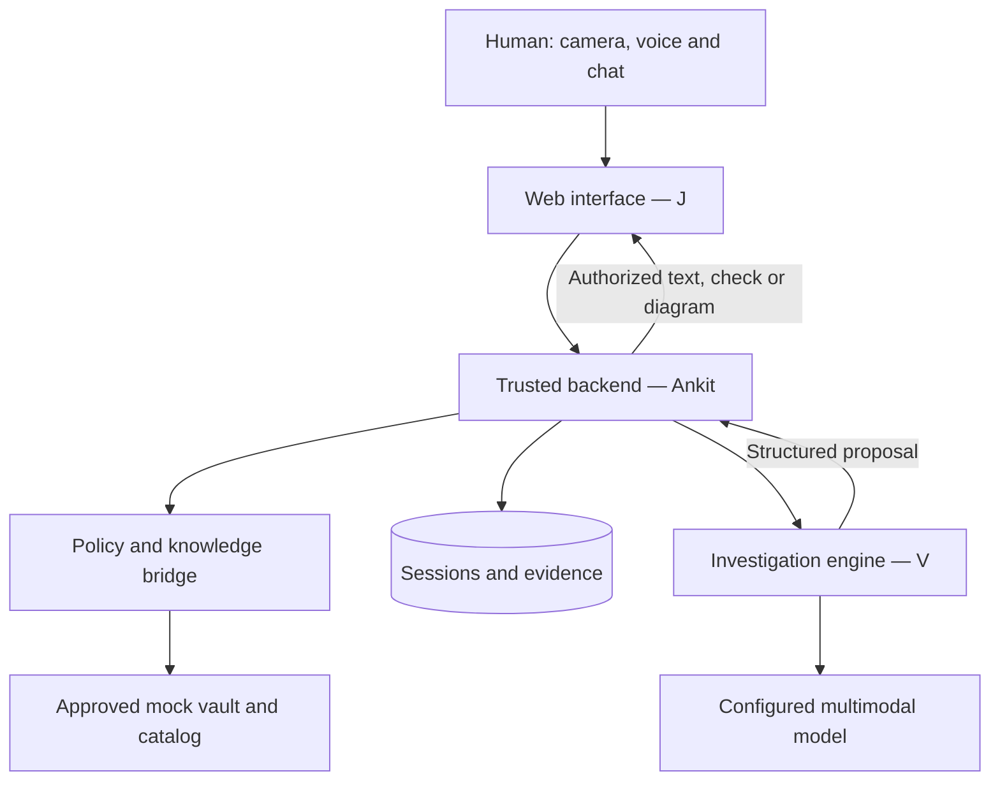

# Architecture explained and open gaps

10 November 2026 | Review note for specification 2.0

This note explains the architecture and records refinements needed before the affected contracts are frozen. It does not amend the current JSON schemas, implement the proposed fixes or close release gates. The behavior contracts remain in [06-CONTRACTS.md](06-CONTRACTS.md).

## Architecture

Mark-1 follows a **modular monolith with an explicit AI trust boundary**: one backend deployment, separate backend and AI modules, one transactional database, and a phone-friendly web client.

The diagram shows responsibility and data access, not separate deployed services. Policy and the bridge belong to A's backend. V receives only A's authorized knowledge subset and cleared media. J never connects directly to a model or vault. R0 uses fictional data and a local mock; real M-Files access remains prohibited in this repository.

| Pattern | Meaning in Mark-1 | Practical benefit |
| --- | --- | --- |
| Modular monolith | Backend and investigator are separate modules in one deployment | Simple deployment with clear ownership |
| Ports and adapters | A calls the defined engine interface; provider details stay in V's adapter | A can develop against a deterministic stub and later integrate V's engine |
| State-machine workflow | Explicit states govern identity, views, questions, explanations, checks, pending writes and stops | Transitions can be validated independently of the model |
| Retrieval-grounded investigation | The investigator selects evidence and next interactions using applicable approved knowledge | Recommendations can be traced to sources and observations |
| Human-in-the-loop control | People confirm identity, report observations and perform physical actions | Model interpretations remain distinct from human confirmations |

This is an agentic loop: **observe -> retrieve -> identify missing evidence -> ask -> reassess**. The model proposes; deterministic backend rules authorize. Model interpretations, human reports and persisted evidence are different types of information. A persisted report does not prove physical truth or a verified repair.

## Open gaps before implementation freeze

The architecture is a useful baseline, but its contracts and implementation still need refinement. The following are open review items, not completed capabilities or silently adopted schema changes.

| ID | Gap in the current baseline | Proposed next change | Implementation owner and review | Evidence needed to close |
| --- | --- | --- | --- | --- |
| AR-01 | `EXPLAIN` requires evidence and a suspected-fault claim, even when the user only wants to understand normal machine flow | Separate flow-only explanation from advisory fault explanation. Flow-only content needs applicable approved sources/diagram, but no causal claim; fault explanations retain claim/evidence rules | A edits contracts; V supplies content semantics; J reviews display | Fixtures accept source-backed flow without a fault claim and reject unsupported causal highlights |
| AR-02 | Frames and evidence IDs exist, but the lifecycle of a model-interpreted visual finding is not fully specified | Define a typed finding linked to frame ID/hash, component when known, uncertainty and provenance. Human confirmation/correction must be a separate event | A owns schema/storage; V perception implementation; J confirmation UX | A finding is traceable to its frame, cannot impersonate a human observation and is invalidated when its supporting context changes |
| AR-03 | Attempt budgets bound loops, but corrections and conflicting reports lack a complete transition/invalidation contract | Specify correction commands, clarification behavior and how dependent claims/check prerequisites are invalidated. Preserve original evidence and append corrections | A owns command/state contract; V clarification strategy; J correction UX | Changing an earlier answer cancels stale inference and removes affected conclusions; unresolved contradiction escalates without invented certainty |
| AR-04 | Browser speech support, processing and cancellation are specified as requirements but unproven on target devices | Select target phone/browser combinations and test edited transcripts, consent, fallback, mute and cancellation under expiry/offline/stop | J implements/tests; A reviews authorization/data boundary | Published browser matrix and demonstrations of text fallback and no stale queued speech |
| AR-05 | Artifact validation has not established runtime security, investigation quality or latency | Build one complete synthetic investigation and its failure branches; then run the held-out evaluation and operational checks | A integration/runtime; V AI evaluation; J experience tests | Version-bound traces, actual latency/cost, failure results and independent review as required by release gates |

AR-01 to AR-03 should be resolved with reviewed contract changes before the affected module work relies on a frozen interface. They can be handled under A-02 with V/J review; A-05/A-07, V-02/V-04/V-06 and J-03/J-05 are downstream consumers. AR-04 maps to J-04/J-06; AR-05 maps to A-08/A-09 and V-07. These IDs are review references, not additional backlog tickets or duplicate owners.

## What the existing checks establish

The recorded 92 schema checks verify positive/negative payload examples. Hash checks verify canonical fixture bytes and schema consistency. Catalog and backlog checks verify selected artifact references and dependencies. They do not establish secure runtime authorization, correct diagnosis, useful camera requests, safe speech behavior or acceptable latency.

Independent v2 review and product gates remain pending. See [validation and release](07-VALIDATION-AND-RELEASE.md) and [the decision register](11-GATE-AND-DECISION-REGISTER.md).

## Recommended implementation direction

Keep the modular monolith, engine port and deterministic backend authority. Resolve the contract gaps above, then demonstrate one complete camera/question/diagram/check journey with durable evidence and handled failures. Add continuous streaming, tracked AR and learning only after the bounded experience has measured results.
